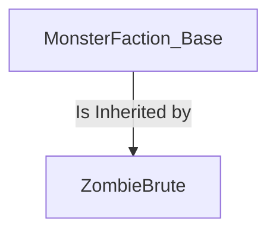
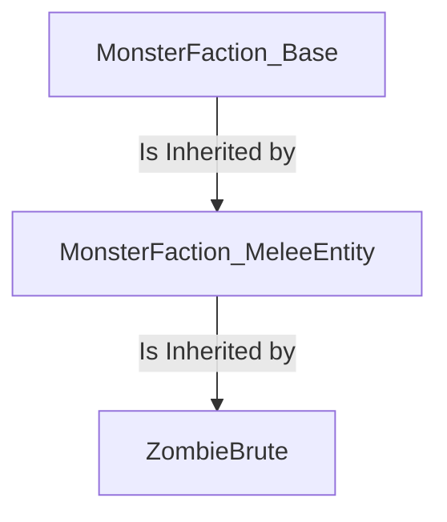
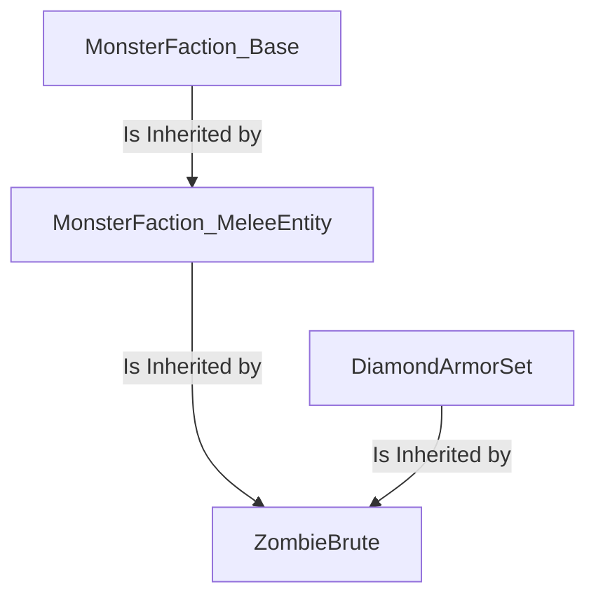

# 模板 {#templates}

模板是一种允许生物“继承”一个或多个其他生物特征的功能。

如果你已经熟悉面向对象编程，那么你可能会发现以下内容与继承的概念非常相似。

模板最初可能不易理解，因此下面会从基础开始，逐步补充细节，再介绍更复杂的用法。

1. [简介](templates.md#introduction)
2. [单个模板](templates.md#single-template)
   1. [共享元素](templates.md#shared-elements)
      1. [字符串值](templates.md#string-value)
      2. [列表值](templates.md#list-value)
      3. [元素值](templates.md#elements-value)
      4. [示例](templates.md#examples)
   2. [排除元素](templates.md#excluding-elements)
3. [链式模板](templates.md#chained-templates)
4. [多模板](templates.md#multi-templates)
5. [物品模板](templates.md#item-templates)

## 介绍 {#introduction}

如前所述，模板允许生物继承另一个生物的特征。但这究竟意味着什么呢？

为了便于理解，先看一个生物示例：

```yaml
ZombieBrute:
  Type: ZOMBIE
  Display: "&2Zombie Brute &7[Lv. <caster.level>]&r"
  Health: 30
  Damage: 5
  Faction: Monster
  Equipment:
  - Iron_Helmet HEAD
  - Iron_Chestplate CHEST
  - Iron_Leggings LEGS
  - Iron_Boots FEET
  - Shield OFFHAND
  Drops:
  - exp 10-15 1
  - rotten_flesh 1-2 1
  - ZombieBrute_Hearth 1 0.01
  Options:
    AlwaysShowName: true
    PreventOtherDrops: true
    PreventRandomEquipment: true
    PreventSunburn: true
    PreventItemPickup: true
    PreventJockeyMounts: true
    PreventTransformation: true
  AITargetSelectors:
  - clear
  - attacker
  - players
  AIGoalSelectors:
  - clear
  - meleeattack
  - randomstroll
  DamageModifiers:
  - PROJECTILE 1.15
  - ENTITY_ATTACK 0.75
  KillMessages:
  - '<target.name> was reduced to paste by a <caster.name>'
  - 'Despite his best efforts, <target.name> could not prevail against a <caster.name>'
  - '<target.name> was killed by a <caster.name>'
  Skills:
  - skill{s=SelectRandomWeapon} @self ~onSpawn
  - skill{s=ZombieBrute_Bash} @target ~onTimer:60 0.4 ?targetwithin{d=10}
  - skill{s=CallZombies} @EIR ~onTimer:180 0.6
```

虽然这个生物并不复杂，但已包含不少配置，例如阵营、掉落物和各种选项。

如果想创建另一个共享部分甚至大多数特征的生物，通常需要将所需配置复制过去。这在短期内可行，但之后要*修改*这些共同特征，就得找出每个使用它们的生物并逐一修改，难以扩展。

模板可以解决这个问题。只需创建一个包含共同特征的生物，其他生物通过模板继承它。之后要修改共同特征时，只需修改这个模板生物，变更就会自动应用到所有使用它的生物，而不必逐一调整。

下面来看第一个实际使用模板的示例。

## 单个模板 {#single-template}

假设要让一组生物共享 ZombieBrute 的阵营、选项、AI、部分技能和其他配置，先把这些共同配置放入一个生物中。

```yaml
MonsterFaction_Base:
  Type: ZOMBIE
  Faction: Monster
  Drops:
  - exp 10-15 1
  Options:
    AlwaysShowName: true
    PreventOtherDrops: true
    PreventRandomEquipment: true
    PreventSunburn: true
    PreventItemPickup: true
    PreventJockeyMounts: true
    PreventTransformation: true
  AITargetSelectors:
  - clear
  - attacker
  - players
  AIGoalSelectors:
  - clear
  - meleeattack
  - randomstroll
  DamageModifiers:
  - PROJECTILE 0.75
  - ENTITY_ATTACK 0.75
  KillMessages:
  - '<target.name> was killed by a <caster.name>'
  Skills:
  - skill{s=SelectRandomWeapon} @self ~onSpawn
```

完成后，让删去这些共同配置的 ZombieBrute 继承它们。

```yaml
ZombieBrute:
  Template: MonsterFaction_Base
  Display: "&2Zombie Brute &7[Lv. <caster.level>]&r"
  Health: 30
  Damage: 5
  Equipment:
  - Iron_Helmet HEAD
  - Iron_Chestplate CHEST
  - Iron_Leggings LEGS
  - Iron_Boots FEET
  - Shield OFFHAND
  Drops:
  - rotten_flesh 1-2 1
  - ZombieBrute_Hearth 1 0.01
  DamageModifiers:
  - PROJECTILE 1.15
  KillMessages:
  - '<target.name> was reduced to paste by a <caster.name>'
  - 'Despite his best efforts, <target.name> could not prevail against a <caster.name>'
  Skills:
  - skill{s=ZombieBrute_Bash} @target ~onTimer:60 0.4 ?targetwithin{d=10}
  - skill{s=CallZombies} @EIR ~onTimer:180 0.6
```

只需为 `ZombieBrute` 添加一行 `Template: MonsterFaction_Base`，它就会继承模板；`MonsterFaction_Base` 中包含的所有配置都会自动由 `ZombieBrute` 继承。



如果生物和模板都定义了同一项配置，会怎样？

### 共享元素 {#shared-elements}

生物与模板包含同名配置时，继承方式取决于该项的*值*。

元素的*值*通常属于以下三类之一：

- 该值为`string`
- 该值是字符串的`list`
- 值为其他 `elements`。

#### 字符串值 {#string-value}

```yaml
TemplateMob:
  Type: ZOMBIE
  Faction: TemplateFaction

ExampleMob:
  Template: TemplateMob
  Faction: ExampleFaction
```

这是最容易理解的情况：从模板（`TemplateMob`）继承字符串值配置时，如果生物（`ExampleMob`）**也定义了同名配置**，模板中的值会被**覆盖**。

> 所以，当你生成 `ExampleMob` 时，它的 `Faction` 将是 `ExampleFaction`，因为生物的元素已经覆盖了模板的元素

#### 列表值 {#list-value}

```yaml
TemplateMob:
  Type: ZOMBIE
  KillMessages:
  - <caster.name> yeeted <target.name>!!

ExampleMob:
  Template: TemplateMob
  KillMessages:
  - You're too weak <target.name>!!
```

从模板（`TemplateMob`）继承值为字符串*列表*的配置时，如果生物（`ExampleMob`）**也定义了同名配置**，两个列表会**合并**。

这意味着结果元素将具有组成原始列表的**所有**字符串，并连接起来

> 所以，当你生成`ExampleMob`时，它的`KillMessages`将是
>

> ```yaml
> - <caster.name> yeeted <target.name>!!
> - You're too weak <target.name>!!
> ```
>

> 按照这个确切的顺序

##### 列表值的顺序 {#order-in-list-values}

某些情况下，继承顺序非常重要，例如指令列表或键值对列表。通常**列表按从上到下的顺序解析**，因此*指令也按此顺序执行*；*键值列表中，最靠下的同名项生效*。

例如，让我们以以下示例为例，其中包含一些 AI 目标

```yaml
TemplateMob:
  Type: ZOMBIE
  AIGoalSelectors:
  - clear
  - meleeattack

ExampleMob:
  Template: TemplateMob
  AIGoalSelectors:
  - clear
  - randomstroll
```

鉴于这种情况，最终的结果将是

```yaml
  - clear
  - meleeattack
  - clear
  - randomstroll
```

结果看起来有些奇怪，但仍有明确逻辑：这里的 `clear` 行为会清除它之前的全部行为，所以实际得到的是：

```yaml
  - clear
  - randomstroll
```

另一个这样的例子是DamageModifiers

```yaml
TemplateMob:
  Type: ZOMBIE
  DamageModifiers:
  - ENTITY_ATTACK 1
  - PROJECTILE 1

ExampleMob:
  Template: TemplateMob
  DamageModifiers:
  - ENTITY_ATTACK 0.5
```

合并后，结果列表将是

```yaml
  - ENTITY_ATTACK 1
  - PROJECTILE 1
  - ENTITY_ATTACK 0.5
```

同名修正项有多个时，最终只计算*最靠下的一项*，因此上式可以改写为：

```yaml
  - PROJECTILE 1
  - ENTITY_ATTACK 0.5
```

#### 元素值 {#elements-value}

```yaml
TemplateMob:
  Type: ZOMBIE
  Options:
    FollowRange: 32
    Despawn: true
    Glowing: false

ExampleMob:
  Template: TemplateMob
  Options:
    FollowRange: 16
```

这些元素作为值还具有其他元素！尽管如此，它们的行为仍然不像其他具有“适当”值的元素那样。

可以把值为其他配置项的项目看作 `folder`，把值为字符串或列表的项目看作 `file`。合并两个文件夹时，*所有文件都会保留*，**但名称和所在文件夹都相同的文件除外**。

同样的事情也发生在这里！

例如，`TemplateMob` 有一个 `Option` 元素，该元素本身又包含一个 `FollowRange` 元素和一个 `Despawn` 元素。当`ExampleMob`继承于`TemplateMobs`时，*所有选项*都被保留，**除了**`FollowRange`，它同时存在于`TemplateMob.Options`和`ExampleMob.Options`中。

现在，它会发生什么？   好吧，`FollowRange` 是一个带有字符串值的元素，因此它的行为就像任何其他[带有字符串值的元素](templates.md#string-value)！同样，此处具有列表值的元素的行为也[与其对应元素类似](templates.md#list-value)

#### 示例 {#examples}

为了使这一点更容易理解，以下是模板可能具有的一些元素的“非详尽”列表，以及如果 Mob 也具有这些元素，Mob 将如何继承它们。

| **元素** *（模板中）* | **继承方式** *（生物也有此项时）* |
| --- | --- |
| Type | 被覆盖 |
| Display | 被覆盖 |
| Health | 被覆盖 |
| Damage | 被覆盖 |
| Armor | 被覆盖 |
| Bossbar | 被覆盖 |
| Faction | 被覆盖 |
| Mount | 被覆盖 |
| Options | 部分覆盖（仅覆盖共有的选项） |
| Modules | 部分覆盖（仅覆盖共有的模块） |
| AIGoalSelectors | Merged* |
| AITargetSelectors | Merged* |
| Drops | 合并 |
| DamageModifiers | 部分覆盖（仅覆盖共有的修饰符） |
| Equipment | 部分覆盖（仅覆盖相同槽位的装备） |
| KillMessages | 合并 |
| LevelModifiers | 部分覆盖（仅覆盖共有的修饰符） |
| Disguise | 被覆盖 |
| Skills | 合并 |
| Trades | 部分覆盖（仅覆盖相同编号的交易） |

* AIGoalsSelector 和 AITargetSelectors 需要特别注意：它们并非简单合并，而是将生物自身的选择器追加到模板选择器之后。例如模板的 AIGoals 为 `clear`、`meleeattack`，生物为 `randomstroll`，最终就是 `clear`、`meleeattack`、`randomstroll`。要重置模板中的选择器，可使用 [`Exclude`](templates.md#excluding-elements)，或添加 `clear` 选择器，清除它之前的全部选择器。

### 排除元素 {#excluding-elements}

可以使用以下语法阻止 Mob 从其模板继承不需要的元素

```yaml
  Exclude:
  - Element1
  - Element2
  - {...}
```

因此，举例来说，如果我们希望生物不继承装备、AITargetSelectors和技能，我们将使用

```yaml
ExampleMob:
  Template: MobTemplate
  Exclude:
  - Equipment
  - AITargetSelectors
  - Skills
```

并且生物现在将不会继承指定的元素。

## 链式模板 {#chained-templates}

模板本身也可以使用模板。再看前面的示例，这次把它进一步拆分。

```yaml
MonsterFaction_Base:
  Type: ZOMBIE
  Faction: Monster
  Drops:
  - exp 10-15 1
  Options:
    AlwaysShowName: true
    PreventOtherDrops: true
    PreventRandomEquipment: true
    PreventSunburn: true
    PreventItemPickup: true
    PreventJockeyMounts: true
    PreventTransformation: true
  DamageModifiers:
  - PROJECTILE 0.75
  - ENTITY_ATTACK 0.75
  KillMessages:
  - '<target.name> was killed by a <caster.name>'
```

```yaml
MonsterFaction_MeleeEntity:
  Template: MonsterFaction_Base
  Equipment:
  - Iron_Helmet HEAD
  - Iron_Chestplate CHEST
  - Iron_Leggings LEGS
  - Iron_Boots FEET
  - Shield OFFHAND
  AITargetSelectors:
  - clear
  - attacker
  - players
  AIGoalSelectors:
  - clear
  - meleeattack
  - randomstroll
  Skills:
  - skill{s=SelectRandomWeapon} @self ~onSpawn
```

```yaml
ZombieBrute:
  Template: MonsterFaction_MeleeEntity
  Display: "&2Zombie Brute &7[Lv. <caster.level>]&r"
  Health: 30
  Damage: 5
  Drops:
  - rotten_flesh 1-2 1
  - ZombieBrute_Hearth 1 0.01
  DamageModifiers:
  - PROJECTILE 1.15
  KillMessages:
  - '<target.name> was reduced to paste by a <caster.name>'
  - 'Despite his best efforts, <target.name> could not prevail against a <caster.name>'
  Skills:
  - skill{s=ZombieBrute_Bash} @target ~onTimer:60 0.4 ?targetwithin{d=10}
  - skill{s=CallZombies} @EIR ~onTimer:180 0.6
```

这样，我们就创建了一个新的生物`MonsterFaction_MeleeEntity`，它使用`MonsterFaction_Base`作为模板。

而`ZombieBrute`使用`MonsterFaction_MeleeEntity`作为模板，它不仅继承了`MonsterFaction_MeleeEntity`的唯一元素，还继承了`MonsterFaction_MeleeEntity`本身迄今为止继承的元素。



## 多个模板 {#multi-templates}

到目前为止，我们已经展示了如何在生物内部使用单个模板，但一个生物可以同时使用多个模板。

将 Template 参数设为模板列表，就能让生物**从列表最左侧到最右侧**依次继承。可以把它理解为将多个模板串成继承链，从最左侧开始，到最右侧结束。

但让我们看一个例子来清楚地说明问题：

```yaml
DiamondArmorSet:
  Type: ZOMBIE
  Equip:
  - Diamond_Helmet HEAD
  - Diamond_Chestplate CHEST
  - Diamond_Leggings LEGS
  - Diamond_Boots FEET
```

这个生物本身没有什么特别的事情，它唯一的特征是它所装备的钻石盔甲。但如果我们像这样使用它：

```yaml
ZombieBrute:
  Template: MonsterFaction_MeleeEntity, DiamondArmorSet
  Display: "&2Zombie Brute &7[Lv. <caster.level>]&r"
  Health: 30
  Damage: 5
  Drops:
  - rotten_flesh 1-2 1
  - ZombieBrute_Hearth 1 0.01
  DamageModifiers:
  - PROJECTILE 1.15
  KillMessages:
  - '<target.name> was reduced to paste by a <caster.name>'
  - 'Despite his best efforts, <target.name> could not prevail against a <caster.name>'
  Skills:
  - skill{s=ZombieBrute_Bash} @target ~onTimer:60 0.4 ?targetwithin{d=10}
  - skill{s=CallZombies} @EIR ~onTimer:180 0.6
```

然后我们亲爱的`ZombieBrute`现在将生成一套闪亮的新钻石盔甲，因为`DiamondArmorSet`模板覆盖了`MonsterFaction_MeleeEntity`中存在的一些装备



---

## 物品模板 {#item-templates}

[物品](../items/items.md#template)可以像生物一样使用模板，同时引用其他物品！

```yaml
MyItem:
  Template: MyOtherItem
```

```yaml
MyOtherItem:
  Template: YetAnotherItem, AndAnotherOne
```
