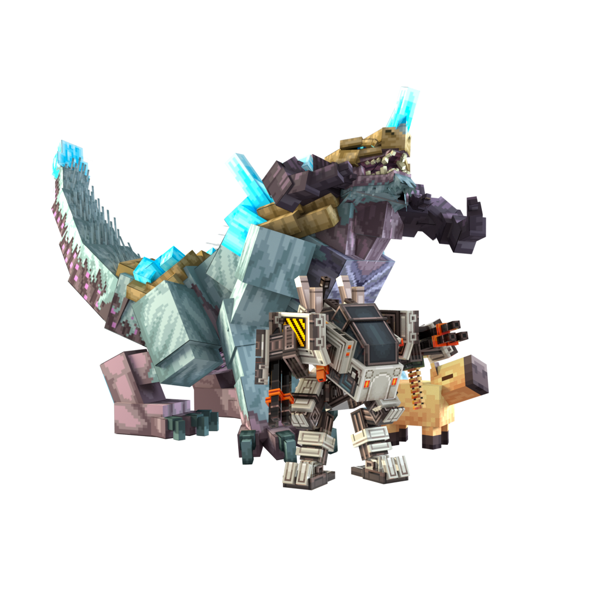

# Model Engine {#model-engine}

### ModelEngine 自定义模型 {#modelengine-custom-models}

**需要安装 [ModelEngine](https://www.spigotmc.org/resources/conxeptworks-model-engine%E2%80%94ultimate-entity-model-manager-1-14-1-16-5.79477/) 插件，并使用自定义资源包。[ModelEngine 最新文档见此处](https://git.lumine.io/mythiccraft/model-engine-4/-/wikis/home)。需要模型方面的帮助时，也可以加入 Mythic 的[支持 Discord](https://discord.com/invite/K3tqXfT)。**

*Modelengine 对一些特殊模型提供免费试用，因此你可以在购买前试用，并且他们的 wiki 上有免费的测试模型。你必须制作或购买自己的模型。*

### 技术细节说完了……那么，为什么要使用 ModelEngine？ {#now-that-the-technical-mumbo-jumbo-is-over-why-use-modelengine}

ModelEngine 让使用 BlockBench 的人可以快速创建自定义模型和碰撞箱，效果类似模组包中的模型，但通过盔甲架和资源包即可在原版客户端使用。

通常建议使用 `PreventOtherDrops` 和 `silent` 生物选项，以避免 ModelEngine 怪物发出奇怪的掉落或噪音



### 技能机制 {#mechanics}

ModelEngine 提供了一些用于将模型应用到生物的技能机制。

要将“kindletronjr”模型应用于生物，你可以在生物的技能部分中使用它：`- model{mid=kindletronjr;n=false} @self ~onSpawn`要播放你制作的攻击动画，你可以将其放在生物的技能部分中：`- state{mid=kindletronjr;s=attack;} @self ~onAttack`

有关属性和机制的完整列表，请访问 ModelEngine wiki：
<https://git.mythiccraft.io/mythiccraft/model-engine-4/-/wikis/home>

### 示例： {#example}

```yaml
KindletronJR:
  Type: SILVERFISH
  Health: 20
  Damage: 0
  Skills:
  - model{mid=kindletronjr} @self ~onSpawn
  - skill{s=KindletronJRInit;sync=true} @self ~onAttack
  Options:
    Silent: true
    MovementSpeed: 0.1
    MaxCombatDistance: 25
    PreventOtherDrops: true
    PreventBlockInfection: true
```

或者，也可以使用以下设置模型的方法：

```yaml
KindletronJR:
  Type: SILVERFISH
  Health: 20
  Damage: 0
  Model:
    Id: kindletronjr
    ViewRadius: 64
    Drive: false
    DamageTint: true
  Skills:
  - skill{s=KindletronJRInit;sync=true} @self ~onAttack
  Options:
    Silent: true
    MovementSpeed: 0.1
    MaxCombatDistance: 25
    PreventOtherDrops: true
    PreventBlockInfection: true
```
