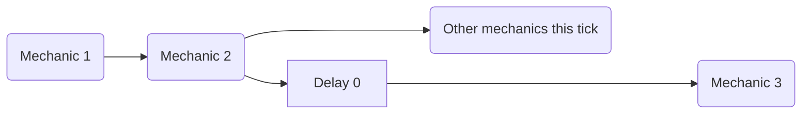
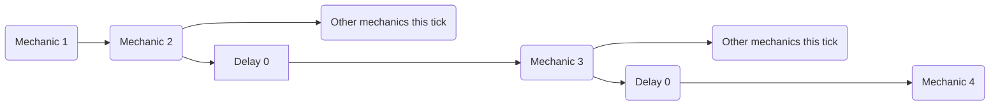

# 刻内调度

[delay](mechanics/delay.md) 不仅能在不同游戏刻*之间*添加延迟，还能用 `delay 0` 在同一游戏刻内延后执行。

# 免责声明 {#disclaimer}

这不是一个预期的机制。这只是一个副作用，由于插件调度程序的运行方式而始终有效

作者发现这一行为后，经过大量测试才记录下来，但仍可能存在未知用法或影响游戏的行为。如有信息可用于完善本页、帮助其他 MythicMobs 用户，请联系 [Lxlp 的 Discord 个人资料](https://discord.com/users/353257382811533322)。

## 单次延迟 {#single-delay}

可以把每个机制视为按序执行的指令。`delay 0` 会把后续机制安排在同一游戏刻的其他未延迟机制之后执行。



### 示例 {#example}

```yaml
ExampleMechanic:
  Skills:
  - skill{s=Skill1} @self
  - skill{s=Skill2} @self

Skill1:
  Skills:
  - delay 0
  - message{m="<skill.var.test>"}

Skill2:
  Skills:
  - setvariable{var=test;val=1}
```

> 执行ExampleMechanic将输出
>

> > - `UNDEFINED` 如果不使用延迟 0
> > - `1`否则

## 多次延迟 {#multiple-delays}

此行为也适用于多次延迟：每执行一次新的 `delay 0`，后续机制就会*再次*排到执行队列后方。



### 示例 {#example-2}

```yaml
ExampleMechanic:
  Skills:
  - skill{s=SkillMessage} @self
  - skill{s=Skill1} @self
  - skill{s=Skill2} @self

Skill1:
  Skills:
  - delay 0
  - setvariable{var=test;val=2}

Skill2:
  Skills:
  - setvariable{var=test;val=1}

SkillMessage:
  Skills:
  - delay 0
  - delay 0
  - message{m="<skill.var.test>"}
```

> 执行ExampleMechanic将输出
>

> > - `UNDEFINED` 如果在 SkillMessage 内部没有使用延迟 0
> > - `1` 如果在 SkillMessage 内部仅使用一个延迟 0
> > - `2` 如果所有延迟都在 SkillMessage 内使用

## 示例 {#examples}

```yaml
ExampleSkill:
  Cooldown: 0
  OnCooldownSkill: ExampleSkill-DisplayCooldown
  Skills:
  - delay 0
  - setSkillCooldown{s=ExampleSkill;seconds=<skill.cooldown>/20} @self
```

> 在此示例中，如果未设置 `delay 0`，则 `setSkillCooldown` 无论如何都会运行，但新的冷却时间值将被 ExampleSkill 覆盖，因为元技能的冷却时间是在执行元技能中的任何非延迟机制之后设置的。
> `delay 0` 可以延后 setSkillCooldown，让它在 ExampleSkill 设置冷却时间之后再覆盖该值，无需额外等待时间，避免延迟可能导致的边界错误。

```yaml
ExampleSkill:
  Skills:
  - delay 0 ?variableisset{var=caster.example}
  - message{m=<caster.var.example>} @self
```

> 本例用 delay 0 确保读取变量前，变量已经有足够时间完成设置。缺点是无法提前确定会产生多少次同刻内延迟；但在原本就不知道变量需要多少次同刻处理才能设好的情况下，这是可以考虑的取舍。
