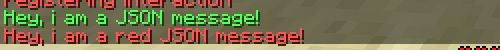
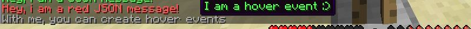
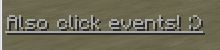

# Jsonmessage {#jsonmessage}

## 说明 {#description}

向目标玩家发送 json 格式的聊天消息。 JSON-消息能够处理悬停事件、点击事件和其他消息机制中不可用的其他一些功能。它们还支持[颜色代码](https://htmlcolorcodes.com/bukkit-color-codes/)和[消息变量](https://wiki.mythiccraft.io/mythicmobs/skills/stringvariables)。

JSON-消息的格式比你的日常消息更高级一些。语法需要一些额外的符号。如果你对编写JSONs一无所知，可以访问[此页面](https://www.minecraftjson.com/)或[此页面](http://minecraft.tools/en/tellraw.php)寻求帮助。

> 注意，双引号必须替换为单引号
> JSON-消息机制

除非你确定你的语法正确，否则请不要在错误报告子论坛中发布与此机制相关的问题。

## 属性 {#attributes}

| 参数 | 别名 | 说明 | 默认值 |
| --- | --- | --- | --- |
| message | m, msg | 要发送的 JSON 消息，必须用双引号括起来。 |  |

## 示例 {#examples}

你可以使用 bukkit 颜色代码或 json 颜色格式：



```yaml
Skills:
  - jsonmessage{m="[{'text':'&aHey, i am a JSON message!'}]"} @trigger ~onInteract
  - jsonmessage{m="[{'text':'Hey, i am a red JSON message!','color':'red'}]"} @trigger ~onInteract
```

##  {#section}

以下是如何使用悬停事件的示例：



```yaml
Skills:
  - jsonmessage{m="[{'text':'&7With me, you can create hover events','hoverEvent':{'action':'show_text','value':{'text':'&aI am a hover event :)'}}}]"} @trigger ~onInteract
```

##  {#section-2}

也可以按以下方式创建点击事件，尤其适合配合 /mm signal 制作交互式任务生物。本例中，玩家点击事件后，会向施放 json-message 的生物发送 <signal> 信号。



```yaml
Skills:
  - jsonmessage{m="[{'text':'&7&nAlso click events! :)','clickEvent':{'action':'run_command','value':'/mm signal <mob.uuid> <signal>'}}]"} @trigger ~onInteract
```

## 别名 {#aliases}

- messagejson
- jmsg
- jm
