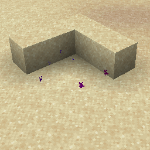

# Dust Color Transition {#dust-color-transition}

## Particle {#particle}



## 属性 {#attributes}

| 参数 | 别名 | 说明 | 默认值 |
| --- | --- | --- | --- |
| color | c, color1, c1, fromcolor, fc | 粒子的起始颜色。 | #FF0000 |
| color2 | c2, tocolor, tc | 粒子渐变到的颜色。 | #0000FF |
| size |  | 粒子的大小。 | 1 |

> 该粒子具有 [Dusttransition](../particle-types.md#dusttransition) 数据类型，并继承其所有属性

## 示例 {#examples}

```yaml
  Skills:
  - particle{p=dust_color_transition;color=#FF0000;color2=#0000FF;size=1}
```

## 别名 {#aliases}

- dustcolortransition
- dustcolor
