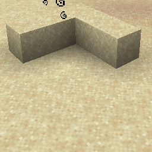

# Entity Effect {#entity-effect}

## Particle {#particle}



## 属性 {#attributes}

| 参数 | 别名 | 说明 | 默认值 |
| --- | --- | --- | --- |
| color | c | 粒子的颜色。 | #FF0000 |

> 该粒子具有 [Color](../particle-types.md#color) 数据类型，并继承其所有属性

## 示例 {#examples}

```yaml
  Skills:
  - particle{p=entity_effect;color=#FF0000}
```

## 别名 {#aliases}

- spell_mob
- mob_spell

> 该粒子在1.20.5之前的版本中具有不同的名称
>

> - spell_mob
