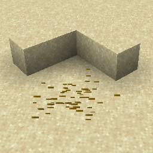

# Falling Honey {#falling-honey}

## Particle {#particle}



## 属性 {#attributes}

> 该粒子没有属性

## 示例 {#examples}

```yaml
  Skills:
  - particle{p=falling_honey}
```

## 别名 {#aliases}

- fallinghoney
