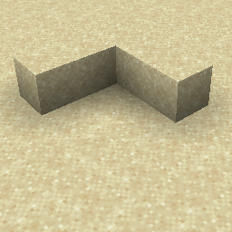

# Falling Water {#falling-water}

## Particle {#particle}



## 属性 {#attributes}

> 该粒子没有属性

## 示例 {#examples}

```yaml
  Skills:
  - particle{p=falling_water}
```

## 别名 {#aliases}

- fallingwater
