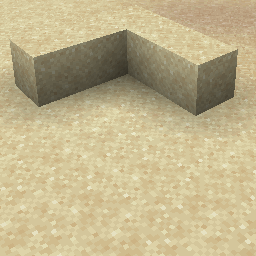

# Instant Effect {#instant-effect}

## Particle {#particle}



## 属性 {#attributes}

| 参数 | 别名 | 说明 | 默认值 |
| --- | --- | --- | --- |
| color | c | 粒子的颜色。 | #FF0000 |
| power | p | 法术粒子的威力。 | 1 |

> 该粒子具有 [Spell](../particle-types.md#spell) 数据类型，并继承其所有属性

## 示例 {#examples}

```yaml
  Skills:
  - particle{p=instant_effect;color=#FF0000;power=1}
```

## 别名 {#aliases}

- spell_instant
- instant_spell

> 该粒子在1.20.5之前的版本中具有不同的名称
>

> - spell_instant
