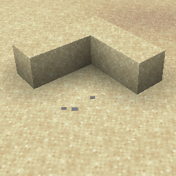

# Item {#item}

## Particle {#particle}



## 属性 {#attributes}

| 参数 | 别名 | 说明 | 默认值 |
| --- | --- | --- | --- |
| material | m | itemstack 粒子所使用的材质。 | STONE |

> 该粒子具有 [Itemstack](../particle-types.md#itemstack) 数据类型，并继承其所有属性

## 示例 {#examples}

```yaml
  Skills:
  - particle{p=item;material=STONE}
```

## 别名 {#aliases}

- item_crack
- icon_crack
- itemcrack

> 该粒子在1.20.5之前的版本中具有不同的名称
>

> - item_crack
