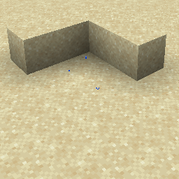

# Rain {#rain}

## Particle {#particle}



## 属性 {#attributes}

> 该粒子没有属性

## 示例 {#examples}

```yaml
  Skills:
  - particle{p=water_drop}
```

## 别名 {#aliases}

- water_drop
- droplet

> 该粒子在1.20.5之前的版本中具有不同的名称
>

> - water_drop
