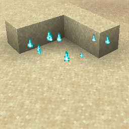

# Soul Fire Flame {#soul-fire-flame}

## Particle {#particle}



## 属性 {#attributes}

> 该粒子没有属性

## 示例 {#examples}

```yaml
  Skills:
  - particle{p=soul_fire_flame}
```

## 别名 {#aliases}

- soulfireflame
- soulfire
- soulflame
