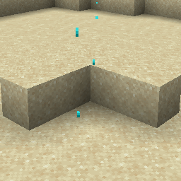

# Trial Spawner Detection Ominous {#trial-spawner-detection-ominous}

## Particle {#particle}



## 属性 {#attributes}

> 该粒子没有属性

## 示例 {#examples}

```yaml
  Skills:
  - particle{p=trial_spawner_detection_ominous}
```
