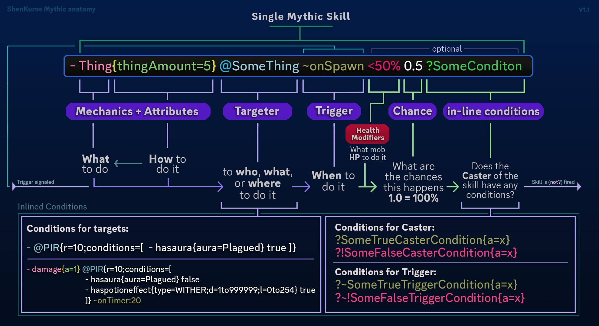

# 技能

技能是 MythicMobs 的核心功能。所有生物都可以拥有各种技能；安装 [Crucible](https://git.mythiccraft.io/mythiccraft/mythiccrucible) 扩展后，物品也可以拥有技能。技能可在不同情况下、满足不同条件时触发。熟悉 MythicMob 的技能系统后，用起来会很直观，既能制作简单的生物，也能制作极为复杂的 Boss。

技能由几个不同的部分组成：

- [机制](mechanics.md)
- [目标选择器](targeters.md)
- [触发器](triggers.md)
- [条件](conditions.md)

# 开始使用 {#getting-started}

技能由哪些部分组成？

技能由[技能机制](mechanics.md)，也就是“基础技能”组成。这些机制本身就是 MythicMobs 自带的简单技能，在生物配置的 **Skills** 部分调用。下面是一个示例：

```yaml
FieryZombie:
  Type: ZOMBIE
  Display: 'Fiery Zombie'
  Health: 50
  Skills:
  - mechanic1
  - skill{skill=Skill1}
  - skill{s=Skill2}
  - skill:Skill3
  - etc
```

每个技能机制都像上例一样，以列表形式添加到生物配置中。那么具体的技能机制是什么样的？下面来看一个实际示例：

```yaml
FieryZombie:
  Type: ZOMBIE
  Display: 'Fiery Zombie'
  Health: 50
  Skills:
  - ignite{ticks=100} @target ~onAttack <50% 0.5
```

这些内容分别是什么意思？先看看这个技能的组成：

```yaml
Skills:
- mechanic{argument=value} @[targeter] ~on[trigger] [health_modifier] [chance]
```

看起来可能仍有些复杂，但各部分本身都很简单，有些甚至是可选的。下面逐一说明！

## 技能机制 {#mechanics}

技能的第一个也是最重要的部分是技能机制，也就是你想执行的基础技能，例如造成伤害、点燃目标或召唤闪电。[可用的技能机制有很多](mechanics.md)，主要分为两类：以实体为目标的机制和以位置为目标的机制。有些同时支持两种目标，有些则都不需要。

大多数技能机制也有参数。参数紧跟在机制名称后，用大括号 {} 包围，多个参数之间用分号 (;) 分隔。每个机制都有自己的参数，可在[技能机制](mechanics.md) Wiki 页面中查询。

```yaml
Skills:
- mechanic{option1=value;option2=value;option2=value;...}
```

也可以将写法展开，让配置更易读，但务必保持正确缩进，否则 YAML 会报错。下面是原作者推荐的格式，清晰且整齐。

```yaml
Skills:
- mechanic{option=value;
           option=value;
           option=value}
```

设置技能机制只需选好所用机制，再填入所需选项。大多数选项都有默认值，可以省略。例如，要让目标燃烧 5 秒，可以使用 ignite 机制，并将 "ticks" 选项设为 100（每秒有 20 个游戏刻）：

```yaml
Skills:
- ignite{ticks=100}
```

## 目标选择器 {#targeters}

目标选择器是使用技能的另一个核心部分，用于决定“技能要作用于什么目标”。目标选择器有很多种，大多可分为“实体”目标和“位置”目标。应根据想实现的效果选用合适的目标选择器。[完整目标选择器列表见此处](targeters.md)。

目标选择器在技能行中紧跟机制，始终以 @ 符号开头。有些目标选择器也有自己的选项，同样放在其后方的大括号中。

```yaml
    Skills:
    - mechanic{option=value} @targeter{option1=value;option2=value;...}
```

回到前面的示例，假设要点燃该生物的目标，只需这样写……

```yaml
Skills:
- ignite{ticks=100} @target
```

如果想点燃附近的**所有**玩家，例如半径 5 格内的玩家……

```yaml
Skills:
- ignite{ticks=100} @PlayersInRadius{radius=5}
```

简单来说，目标选择器决定了技能机制要作用于哪些目标。

## 触发器 {#triggers}

触发器也是技能中非常重要的一部分。触发器决定“是什么导致该技能发生”。

触发器紧跟目标选择器，通常以 **~on** 开头，后面接触发器名称。

```yaml
Skills:
- mechanic{option=value} @targeter{option=value} ~onTrigger
```

回到前面的示例，假设要在生物攻击目标时触发，让它的近战攻击同时点燃目标。

```yaml
Skills:
- ignite{ticks=100} @target ~onAttack
```

一些目标选择器也会与特定触发器配合使用。例如，@Trigger 会选中触发技能的实体。在下面的示例中，右键点击生物（与生物交互）的玩家会被点燃，因为该玩家就是 @Trigger。

```yaml
Skills:
- ignite{ticks=100} @Trigger ~onInteract
```

**注意：物品使用另一套触发器。[点击此处查看 Crucible 支持的触发器](https://git.mythiccraft.io/mythiccraft/mythiccrucible/-/wikis/Skills/Triggers)。**

## 生命值修饰符 {#health-modifiers}

生命值修正是一种特殊条件，写在触发器后，用于设置技能执行时所需的生命值范围，完全可以省略。生命值修正有几种简单形式，例如：

- **=90%** - 仅在生物生命值低于 90% 时触发技能。请注意，使用此修正会使该技能只触发一次。
- **<50%** - 仅在生物生命值低于 50% 时触发技能。
- **=30%-50%** - 仅在生物生命值介于 30% 和 50% 之间时触发技能。
- **<2000** - 仅在生物生命值低于 2000 时触发技能。
- **>500** - 仅在生物生命值高于 500 时触发技能。

生命值修正紧跟触发器，根据所需范围以 **=**、**<** 或 **>** 开头。

```yaml
Skills:
- mechanic{option=value} @targeter{options=value} ~onTrigger =/</> HealthModifier
```

回到前面的示例，假设要让技能仅在生物生命值低于 50% 时生效：

```yaml
Skills:
- ignite{ticks=100} @target ~onAttack <50%
```

## Chance {#chance}

概率是另一种简单且可选的条件，可添加到技能行中。概率始终放在技能行末尾，以小数表示：1.0 为 100%，0.5 为 50%，0 为 0%。

将这些内容组合起来，假设要让生物在生命值低于 50% 时，每次近战攻击有 50% 的概率触发该技能：

```yaml
Skills:
- ignite{ticks=100} @target ~onAttack <50% 0.5
```

# 总结 {#wrapping-it-all-up}

可见，最初看似复杂的技能，拆开后就容易理解了。

掌握单个基础技能的用法后，可以使用元技能将它们组合成更复杂的技能。后续文章会介绍这一点。

# 速查表 {#cheat-sheet}



> 也可以参考 [ShenKuro](https://discord.com/users/695202854134218763) 制作的这张图解
