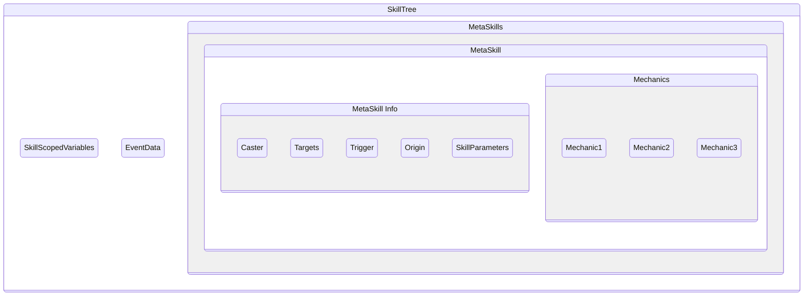

# 技能树

技能树（SkillTree）是 Mythic 的一项隐式功能。虽然无法像[元技能](metaskills.md)等功能一样直接调用，但它同样重要。

**每当触发器触发一个技能机制时，都会创建技能树**。技能作用域的[变量](variables.md)存储在技能树中，[元技能](metaskills.md)也在其中运行

1. [技能树结构](skilltrees.md#skilltree-structure)
   1. [技能作用域变量](skilltrees.md#skill-scoped-variables)
   2. [事件数据](skilltrees.md#event-data)
   3. [元技能](skilltrees.md#metaskills)
      1. [施法者](skilltrees.md#caster)
      2. [目标](skilltrees.md#target)
      3. [触发者](skilltrees.md#trigger)
      4. [原点](skilltrees.md#origin)
      5. [技能参数](skilltrees.md#skill-parameters)

# 技能树结构 {#skilltree-structure}

## 技能作用域变量 {#skill-scoped-variables}

技能作用域变量存在于技能树本身，因此从变量创建的那一刻起，该技能树中的任何[元技能](metaskills.md)都可以访问和修改它，无论它由哪个[元技能](metaskills.md)创建

## 事件数据 {#event-data}

技能树始终记录触发它的事件。因此，只要同步执行，就可以在技能树调用的任意元技能中，使用 [cancelevent](mechanics/cancelevent.md) 机制取消该事件

## MetaSkills {#metaskills}

在技能树中调用的每个[元技能](metaskills.md)，都有一组关于不同元素的数据。通常，这些值从调用它的元技能复制而来，除非另行覆盖。包括以下元素：

### `Caster` {#caster}

施放元技能的实体。

- 可以通过使用 [sudoskill](mechanics/sudoskill.md) 机制进行更改

### `Target` {#target}

元技能的[继承目标](metaskills.md#inheritance)

### `Trigger` {#trigger}

最初设为触发技能树的实体，可以通过 [@trigger](targeters/trigger.md) 或类似的目标选择器获取。视所用的 [~Trigger](triggers.md) 而定，[@trigger](targeters/trigger.md) 也可能不存在。

- 可以使用 [sudoskill](mechanics/sudoskill.md) 机制的 `casterastrigger` 属性更改 `Trigger`，使被调用元技能的 `Trigger` 变为原元技能的 `Caster`

### `Origin` {#origin}

元技能的 [@origin](targeters/origin.md)，默认为 `Caster` 所在位置。

- 可以通过`origin`[通用属性](mechanics.md#universal-attributes)设置
- 使用 [projectile](mechanics/projectile.md) 等机制时会自动设置

### `Skill Parameters` {#skill-parameters}

元技能的[技能参数](metaskills.md#skill-parameters-premium-feature)。请注意，它们与[技能作用域变量](skilltrees.md#skill-scoped-variables)不同，并不存储在技能树本身。
