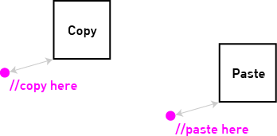
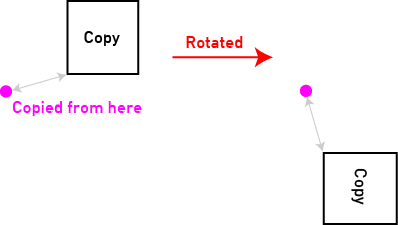
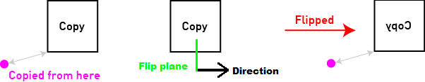

# 剪贴板 { #clipboard }

WorldEdit 的剪贴板功能可以复制区域、粘贴，还能保存为文件或从文件加载。目前剪贴板内容仅支持长方体，复制时使用当前选区。

<a id="contents"></a>

- [复制与剪切](#copy-and-cut)

- [粘贴](#pasting)

- [旋转](#rotating)

- [翻转](#flipping)

- [加载与保存](#loading-and-saving)


  - [原理图管理](#schematic-management)

  - [原理图存储位置](#schematic-storage)

- [分享](#sharing)

与[历史记录](general/history.md)一样，当前剪贴板保存在会话中，因此退出服务器后仍会保留 10 分钟。

同样与历史记录类似，可以使用 /clearclipboard 命令清空当前剪贴板。

## 复制与剪切 { #copy-and-cut }

`//copy` 命令会将当前选区复制到会话的剪贴板中，**并记录你相对于复制内容的位置**。后半句话非常重要：例如，如果希望之后粘贴一座桥时，桥出现在自己脚下，那么复制时就必须站在桥上方。只要事先规划，这种方式就方便你在之后粘贴时对齐位置。掌握复制过程需要一定的空间想象能力，但熟悉后会发现它很实用。

`//cut` 与 `//copy` 的工作方式相同，但复制后还会删除选中区域。默认会留下空气，也可以指定其他方块填补原处。

!!! note "注意"

    它会记住你**当前相对于复制内容的位置**。务必理解这一点，否则就难以控制复制内容的粘贴位置！

这两个命令还有三个附加选项：

- 指定 `-e`，同时复制或剪切选区中的实体。

- 指定 `-b`，同时复制选区中的生物群系（“剪切”生物群系没有意义，因为原处总得保留某种生物群系）。

- 使用 `-m <mask>` 指定要复制或剪切的方块[蒙版](general/masks.md)。不匹配的方块在剪贴板中会替换为空气。

## 粘贴 { #pasting }

剪贴板中有内容后，就可以将其粘贴到世界里。最后一个参数可选：如果希望粘贴回复制时的原位置，输入 `//paste -o`；否则会相对于你当前的位置进行粘贴。**记住，相对粘贴会参照最初复制时你所在的位置。**例如，复制城堡时站在城堡顶上，那么粘贴后城堡就会出现在你脚下。

<a id="id1"></a>



*剪贴板相对位置的工作方式简介*

与复制和剪切命令一样，粘贴命令也支持相同的三个选项：

- 指定 `-e`，同时粘贴实体（前提是剪贴板中包含实体）。

- 指定 `-b`，同时粘贴生物群系（前提是剪贴板中包含生物群系）。

- 使用 `-m <mask>` 指定要粘贴的方块[蒙版](general/masks.md)。不匹配蒙版的方块不会粘贴。

此外，还有一些附加选项：

- `-a` 不粘贴剪贴板中的空气，等同于 `-m #existing`。`-a` 与 `-m` *可以*一起使用（也可以直接将 `#existing` 加入蒙版）。

- `-s` 会将选区设为粘贴内容所占的区域。

- `-n` 与 `-s` 一样会设置选区，但*不会*实际粘贴任何内容。可以用它在粘贴前检查剪贴板内容最终会出现在何处。

- 如上所述，`-o` 会将剪贴板内容粘贴回原始位置，完全忽略“相对位置”。

## 旋转 { #rotating }

有时你可能希望旋转复制的内容。`//rotate <y> [x] [z]` 命令目前允许绕 Y 轴（上下方向）旋转 90 度或 90 度的任意倍数。准确地说，是围绕最初复制时你所在的相对位置旋转复制内容。如果希望绕中心旋转，就需要在复制时站在复制内容的中心。

旋转命令也可以接受绕 X 轴或 Z 轴旋转的角度，但未使用的轴必须填 0。例如，绕 X 轴旋转用 `//rotate 0 90`，绕 Z 轴旋转用 `//rotate 0 0 90`。这两个轴可以让竖直的结构变为水平，或让水平的结构变为竖直。

<a id="id2"></a>



*围绕你的相对位置旋转*

## 翻转 { #flipping }

`//flip [direction]` 命令会沿垂直于指定方向的平面翻转当前剪贴板。默认方向为你面朝的方向，也可以明确指定。有三个可用的翻转平面：XY、YZ 和 XZ。下表列出对应关系供参考。

<table>
<colgroup>
</colgroup>
<thead>
<tr>
<th markdown="span">方向</th>
<th markdown="span">平面</th>
</tr>
</thead>
<tbody>
<tr>
<td markdown="span">`north` 或 `south`</td>
<td markdown="span">XY</td>
</tr>
<tr>
<td markdown="span">`east` 或 `west`</td>
<td markdown="span">YZ</td>
</tr>
<tr>
<td markdown="span">`up` 或 `down`</td>
<td markdown="span">XZ</td>
</tr>
</tbody>
</table>

<a id="id3"></a>



*沿平面翻转剪贴板*

## 加载与保存 { #loading-and-saving }

WorldEdit 可以使用“原理图”文件，将剪贴板保存到磁盘或从磁盘加载。

要将当前剪贴板保存为文件，使用 `//schem save <filename>`。

要加载已保存的原理图，使用 `//schem load <filename>`。

关于原理图格式

WorldEdit 7 之前的版本（对应 Minecraft 1.13）使用“.schematic”扩展名保存文件，所用格式兼容 MCEdit、Redstone Simulator 等许多软件。但该格式不适用于 Mojang 正在迁移的新方块格式，因此制定了名为 [Sponge 原理图格式](https://github.com/SpongePowered/Schematic-Specification)的新格式，扩展名为“.schem”。

WorldEdit 仍然可以通过旧版兼容层导入旧版本（或第三方程序）保存的“.schematic”文件，但已经无法再以该格式写入。

相对位置与原理图

复制内容的原点和你相对于复制内容的偏移量都会保存在文件中。因此，日后重新加载时，可以粘贴到原位置，也可以像刚复制时一样，相对于你的位置粘贴。你应先熟悉 `//copy` 和 `//paste` 保存相对位置的方式。

使用该格式的第三方软件不一定像 WorldEdit 一样使用相对位置，因此文件中可能不包含这些信息。

### 原理图管理 { #schematic-management }

列出可用原理图

```text
//schem list [-dn] [-p <page>]
```

使用 `-d` *或* `-n` 选项，可按文件修改时间从新到旧或从旧到新排序。`-p` 选项可获取指定页码。此命令的输出可以交互：底部箭头会自动获取上一页或下一页，左侧的 `[L]`“按钮”会加载对应原理图。

删除原理图

```text
//schem delete <filename>
```

列出可用格式

```text
//schem listformats
```

虽然上面的说明只提到了旧“MCEdit”原理图格式和新“Sponge”原理图格式，但 WorldEdit 实际上并不限制剪贴板的存储方式。第三方插件可以向 WorldEdit 注册新格式，用于保存和／或加载。

### 原理图存储位置 { #schematic-storage }

原理图从 WorldEdit 的原理图文件夹保存和加载。该文件夹默认名为 `schematics`，可以在[配置](../config.md)中更改。首次在游戏内保存原理图时才会创建此文件夹。如果已从其他地方下载原理图并希望添加进来，也可以手动创建。该文件夹必须位于 WorldEdit 的配置文件夹内：Bukkit/Spigot/Paper 上为 `plugins/WorldEdit`，其他平台为 `config/worldedit`。因此，**默认情况下**，原理图文件夹位于 `plugins/WorldEdit/schematics` 或 `config/worldedit/schematics`。

!!! note "注意"

    如果希望多个服务器或安装共用原理图文件夹，或者想将它存放在其他位置，必须在配置中启用“allow-symbolic-links”选项。

!!! tip "提示"

    虽然保存和加载命令要求输入文件名，但也可以使用 `folder/file`，这样会在原理图文件夹中创建子文件夹。这可以用来整理原理图。

## 分享 { #sharing }

WorldEdit 内置了在线分享原理图文件的功能。

使用 `//schem share` 将当前剪贴板分享到网上。也可以使用 `//schem share [name] [destination] [format]` 语法指定原理图名称，以及其他上传目标和格式。

分享目标

默认情况下，WorldEdit 将原理图上传到 [EngineHub Paste Service](https://paste.enginehub.org/)。其他插件和模组可以使用 WorldEdit API 注册新的分享目标，再通过该命令的目标参数上传。

上传到 EngineHub Paste Service 的原理图会在一个月后删除。此服务只应用于短期分享链接，不应作为长期下载地址。
