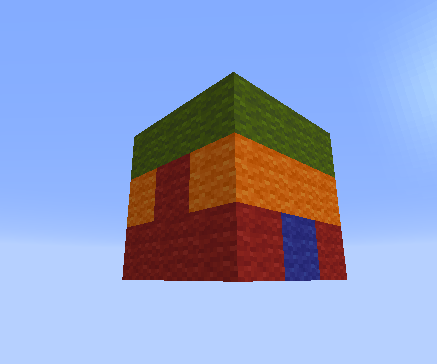
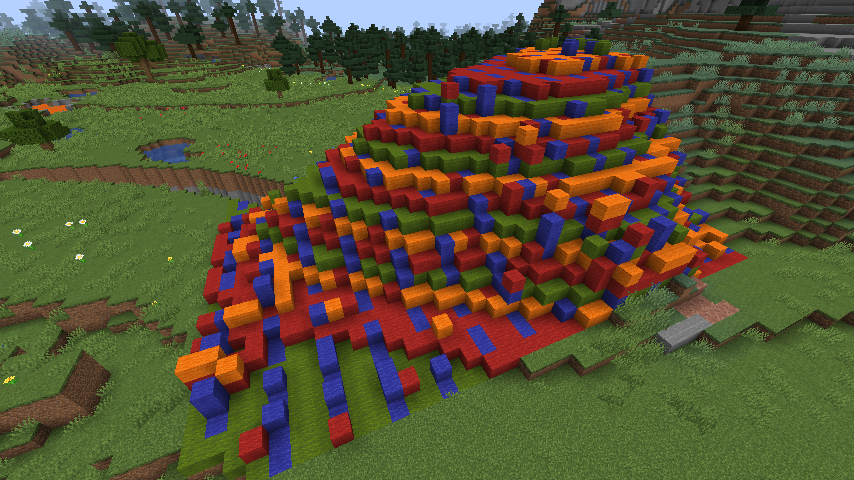

# 方块模式 { #patterns }

你可能已经注意到（即使还没有，很快也会发现），许多 WorldEdit [命令](../../commands.md)会将“方块模式”作为参数。方块模式可以非常简单（例如单一方块 `stone`），也可以很复杂。它决定命令、工具等操作会在世界中设置什么方块。

<a id="contents"></a>

- [可用方块模式](#available-patterns)


  - [单一方块模式](#single-block-pattern)

  - [随机方块模式](#random-pattern)

  - [随机状态模式](#random-state-pattern)

  - [剪贴板模式](#clipboard-pattern)

  - [应用类型或状态的模式](#type-or-state-applying-pattern)

  - [方块类别模式](#block-category-pattern)

- [特殊方块数据语法](#special-block-data-syntax)


  - [告示牌文本](#sign-text)

  - [玩家头颅](#player-heads)

  - [刷怪笼](#mob-spawners)

## 可用方块模式 { #available-patterns }

!!! note "注意"

    随着 WorldEdit 加入新的方块模式，此列表可能不完整。此外，其他插件还可以通过我们的 API 注册新的方块模式，这里也不会列出它们。

!!! tip "提示"

    此视频详细介绍了其中一些在 WorldEdit 7 中加入的方块模式：[https://www.youtube.com/watch?v=S5wCVMf3SvM](https://www.youtube.com/watch?v=S5wCVMf3SvM)。

### 单一方块模式 { #single-block-pattern }

最基础的方块模式，只包含一种方块。方块由三部分标识：[方块类型](https://minecraft.wiki/w/Java_Edition_data_values#IDs)、附加的[方块状态](https://minecraft.wiki/w/Block_states)和 [NBT 数据](https://minecraft.wiki/w/NBT_format)。这三个 Minecraft Wiki 链接，加上 WorldEdit 命令内置的 Tab 补全，可以帮助你指定所需方块。附加状态始终使用 `block_type[state1=value,state2=value,...]` 语法写在类型后面。如果没有指定状态，或省略了部分状态，这些状态会采用默认值。NBT 使用 Minecraft 的 SNBT 语法编写，即 `block_type{'nbt_key':'value'}`。如果同时提供方块状态，NBT 数据必须放在状态之后：`block_type[property=value]{'nbt_key':'value'}`。

除了直接指定方块类型，还可以用 `hand` 或 `offhand`，分别使用主手或副手持有的方块。需要的方块已经在快捷栏中时，这种方式很方便。也可以用 `pos1`，使用选区主点处的方块。各类选区中主点的含义见[选区模式](../regions/selections.md#selection-modes)。目前只有 `pos1` 会保留状态或 NBT（例如，手持潜影盒使用 `hand`，放置的会是空盒子）。

使用这些写法时，仍然可以像普通方块类型一样设置状态和 NBT。状态和 NBT 都会进行顶层合并，命令中指定的键优先。

示例：单一方块模式

将选区设为石头：

```text
//set stone
```

将选区设为使用指定乐器和音高的音符盒：

```text
//set note_block[instrument=chime,note=18]
```

将选区设为朝东的倒置橡木楼梯：

```text
//set oak_stairs[facing=east,half=top]
```

将选区设为已涂蜡的橡木告示牌：

```text
//set oak_sign{'is_waxed':1}
```

将选区设为已涂蜡且经过旋转的橡木告示牌：

```text
//set oak_sign[rotation=12]{'is_waxed':1}
```

将选区设为主手持有的方块：

```text
//set hand
```

将选区设为主手持有的方块，并覆盖其 `facing` 状态：

```text
//set hand[facing=east]
```

将选区设为副手持有的方块：

```text
//set offhand
```

将选区设为 pos1 处的方块：

```text
//set pos1
```

### 随机方块模式 { #random-pattern }

此模式可以从任意数量的其他方块模式中随机选择并设置方块。最简单的写法是用逗号分隔多个方块模式，选择概率相同。也可以用 `<x>%<pattern>` 为各个模式指定权重。

示例：随机方块模式

将选区设为均匀分布的不同种类石头：

```text
//set stone,diorite,andesite,granite
```

将选区设为以红色羊毛为主、混入少量玻璃的方块（比例为 5:1，见下方说明）：

```text
//set 50%red_wool,10%red_stained_glass
```

!!! note "注意"

    虽然使用百分号，权重之和却不必等于 100。所有权重会相加，再用各自权重除以总和。也就是说，`5%dirt,15%stone` 表示 25% 的方块为泥土，75% 为石头。换言之，权重是彼此之间的比例，而不是相对于 100 的比例。因此，`5%dirt` 这一模式无效。如果只想将 5% 的方块设为泥土，应使用[随机噪声蒙版](masks.md#random-noise-mask)。

!!! tip "提示"

    备选项可以使用任何其他方块模式，并不限于单一方块模式。继续阅读以了解更多模式……

### 随机状态模式 { #random-state-pattern }

在任意方块类型前加星号（`*`），会在每个位置从该方块的所有状态中随机选择。

示例：随机状态模式

设置朝向随机的橡木原木：

```text
//set *oak_log
```

### 剪贴板模式 { #clipboard-pattern }

`#clipboard` 模式会按相同排列使用[剪贴板](../clipboard.md)中的方块。这样可以先手工搭建复杂重复图案的一部分，再不断重复它。还可以添加 `@[x,y,z]` 来偏移图案。

示例：使用剪贴板模式

将[所有现有方块](masks.md#existing-block-mask)替换为剪贴板内容：

```text
//replace #existing #clipboard
```

**使用第一张图片中的剪贴板替换山丘。注意重复出现的层次。**

[](../../assets/267d2572c9d0-clipboard.png) [](../../assets/3b0ac7b7a5bb-clipboard_replace.png)

使用偏移来对齐剪贴板：

```text
//set #clipboard@[2,0,1]
```

### 应用类型或状态的模式 { #type-or-state-applying-pattern }

此模式以 `^` 为前缀，可以只设置方块的类型或状态，而不改动其余内容。例如，将螺旋楼梯从橡木改为金合欢木时，不必担心各个楼梯的朝向等属性。可以指定方块类型（只更改类型，并在适用时保留状态），也可以指定任意数量的状态（在适用时只更改这些状态）。

示例：应用类型或状态的模式

将所有橡木楼梯替换为金合欢木楼梯，同时保留朝向等属性：

```text
//replace oak_stairs ^acacia_stairs
```

移除所有可含水方块中的水：

```text
//set ^[waterlogged=false]
```

将所有台阶变为双层台阶：

```text
//replace ##slabs ^[type=double]
```

将所有楼梯随机替换为不同种类的楼梯，同时保留朝向等属性：

```text
//replace ##stairs ^##stairs
```

### 方块类别模式 { #block-category-pattern }

此模式可以随机设置某个方块类别中的方块，类别通常称为“[标签](https://minecraft.wiki/w/Tag)”。标签允许将多个方块归到一个名称下。Minecraft 内置了许多标签（见链接），也允许通过数据包创建和修改标签。你可能已经注意到，上面的示例使用标签作为[蒙版](masks.md#block-category-mask)（`##slabs`）。

此模式的语法为 `##<tag name>`，会从该类别所有方块的默认状态中随机选择。也可以与随机状态模式组合（`##*<tag name>`），使用所有状态，而不仅是默认状态。

示例：使用方块类别模式

将所有现有方块替换为彩虹色羊毛：

```text
//replace #existing ##wool
```

将选区设为随机种类的台阶，随机使用上半、下半或双层状态，并随机决定是否含水：

```text
//set ##*slabs
```

## 特殊方块数据语法 { #special-block-data-syntax }

某些方块提供了设置额外信息的附加语法。

### 告示牌文本 { #sign-text }

可以用竖线符号（`|`）分隔各行，设置告示牌上的文本。如果文本含空格，必须用引号 `""` 包住整个方块模式。

示例：设置告示牌文本

简单示例：

```text
//set oak_sign|Line1|Line2
```

包含空格并设置旋转：

```text
//set "oak_wall_sign[facing=north]|Hello world|Second|Third line"
```

### 玩家头颅 { #player-heads }

在竖线符号后指定用户名，可以设置玩家头颅的皮肤。

示例：设置头颅皮肤

```text
//set player_head|dinnerbone
```

### 刷怪笼 { #mob-spawners }

可以设置要生成的生物类型（同样使用竖线符号）。生物名称必须是[实体 ID](https://minecraft.wiki/w/Java_Edition_data_values#Entities)。minecraft: 前缀可以省略，模组生物则必须包含命名空间。

示例：创建鱿鱼刷怪笼

```text
//set spawner|squid
```
