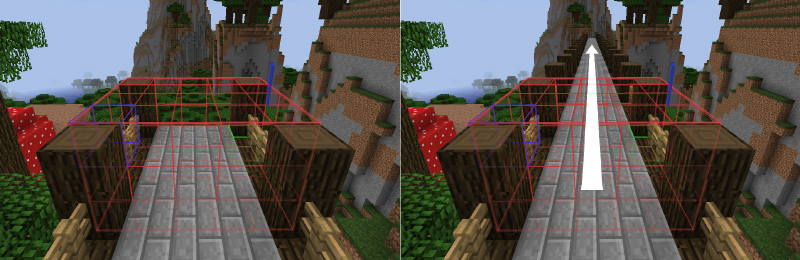
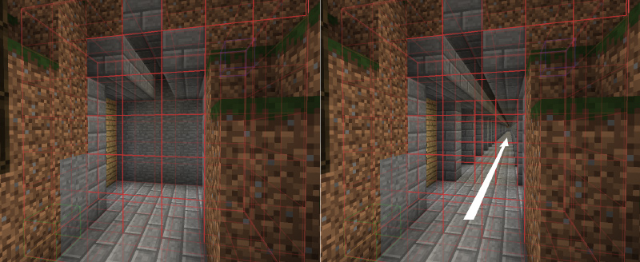
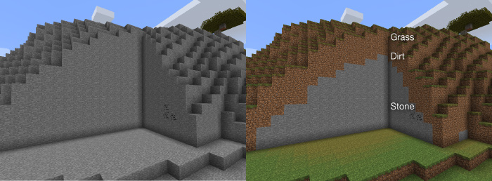

# 选区操作 { #region-operations }

[选好区域](selections.md)后，就可以开始真正有趣的操作了。

<a id="contents"></a>

- [设置方块](#setting-blocks)

- [替换方块](#replacing-blocks)

- [建造墙壁及其他轮廓](#building-walls-and-other-outlines)

- [覆盖表面](#overlaying)

- [堆叠](#stacking)

- [移动](#moving)

- [平滑](#smoothing)

- [重新生成](#regenerating)

- [自然化](#naturalizing)

- [放置植物](#placing-flora)

- [生成森林](#generating-forests)

- [挖空区域](#hollowing-areas)

- [创建直线与曲线](#creating-lines-and-curves)

- [在中心设置方块](#setting-a-block-in-the-center)

- [选区变形](#deforming-regions)

- [设置生物群系](#setting-biomes)

## 设置方块 { #setting-blocks }

这是最基础的操作。`//set <pattern>` 命令可以将选区内的所有方块设为给定方块模式。

示例：设置选区内容

简单方块模式：

```text
//set stone
```

复杂[方块模式](../general/patterns.md)：

```text
//set 30%red_wool,*oak_log,#copy,##slabs
```

## 替换方块 { #replacing-blocks }

如果不想设置选区内的*所有*方块，可以通过 `//replace [mask] <pattern>` 命令指定蒙版，决定哪些方块会受影响。

可以省略命令中的蒙版参数，此时默认使用[现有方块蒙版](../general/masks.md)。

示例：替换选区内的方块

将所有非空气方块替换为草方块：

```text
//replace grass_block
```

将所有石头替换为 green_wool：

```text
//replace stone green_wool
```

将表面的沙子替换为金属方块：

```text
//replace "sand <air" diamond_block,iron_block,gold_block
```

## 建造墙壁及其他轮廓 { #building-walls-and-other-outlines }

有时你会想创建墙壁或其他空心形状，主要有两种方式：

对于长方体选区，`//faces <pattern>` 命令（别名：`//outline`）可以填充全部 6 个面（上、下、北、南、东、西）。对其他类型的选区使用此命令时，会先创建包围盒（即完全包含所选形状的长方体区域），再创建该长方体的各个面。

对于任何类型的选区，`//walls <pattern>` 命令都可以创建不含顶面和底面的空心外壳。具体效果取决于选区类型。

## 覆盖表面 { #overlaying }

`//overlay <pattern>` 命令可以在选区中的方块上覆盖另一种方块（或方块模式）。选区顶部必须“敞开”：命令会从选区上方的方块开始，逐列向下寻找非空气方块，再在其上方放置指定方块模式。可以用它在现有地形上放置火把、栅栏／墙、道路方块等。

## 堆叠 { #stacking }

`//stack <count> [direction]` 命令可以沿给定方向将选区重复指定次数，本质上就是反复复制并粘贴选区。

如果没有指定方向，就沿你面朝的方向堆叠。

用途包括：

- 延长桥梁

- 制作隧道

- 重复手工建造的结构片段

可以使用以下选项：

- `-m <mask>` 设置源[蒙版](../general/masks.md)，只堆叠匹配的方块。

- `-e` 同时将实体复制到各个堆叠区域。

- `-b` 同时将生物群系复制到各个堆叠区域（可能需要重新进入世界才能看到变化）。

堆叠命令的部分用途

<a id="id2"></a>



*使用 `//stack` 延长的桥梁*

<a id="id3"></a>



*快速挖出穿山隧道。记得将顶面和地板方块也选入选区。*

## 移动 { #moving }

```text
//move <distance> [direction] [fill pattern]
```

如果建好东西后才发现需要向旁边移一点，这个命令就很有用，它可以将整个区域一起移动。命令接受移动距离、可选的方向，以及用于填充移动后原处空缺的方块。

方向参数的用法与 `//stack` 命令相同，可以使用任意方向，默认为“me”，即当前面朝的方向。

如果没有指定填充方块，原处留下的区域会用空气填充。

还可以使用 `-s` 选项，让选区随方块一起移动，使新选区与移动后的方块保持在同一位置。

移动命令也支持与 `//stack` 相同的三个选项：`-e` 移动实体，`-b` 复制生物群系（原处生物群系不受影响），`-m <mask>` 只移动匹配的方块。

示例：使用移动命令

将选区向前移动 2 个方块，原处留下石头：

```text
//move 2 me stone
```

将选区向下移动 5 个方块，原处留下空气：

```text
//move 5 down
```

## 平滑 { #smoothing }

`//smooth [iterations]` 命令会平滑地形。增加迭代次数可以让区域更平滑。此命令基于高度图工作，擅长平滑地表，但不适合平滑洞穴、墙壁或物体。

## 重新生成 { #regenerating }

`//regen` 命令会将选区重新生成为世界刚生成时的状态。它基于世界当前的生成器和种子，因此执行多次也会产生相同结果。

!!! warning "警告"

    重新生成命令会使用当前世界生成器。因此，如果世界是通过外部工具生成的，或者 Minecraft 的地形生成方式后来发生了变化，重新生成的区域就会与周围不一致。如果条件允许，考虑提前备份整个世界，供[备份快照](../snapshots.md)功能使用。

## 自然化 { #naturalizing }

`//naturalize` 命令会创建一层草方块，下面依次为泥土层和石头，使地形自然化。

<a id="id4"></a>



*让地面呈现自然外观。*

## 放置植物 { #placing-flora }

`//flora` 命令会在选区的草方块上散布高草和花，在沙子上散布仙人掌和枯草。如果需要更复杂的方块模式，可以使用作用类似的覆盖表面功能。

## 生成森林 { #generating-forests }

`//forest <tree type> [density]` 命令会种植由指定树木组成的森林。密度必须在 0 到 100 之间，用来控制 WorldEdit 在区域内尝试种树的频率，默认为 5。

## 挖空区域 { #hollowing-areas }

`//hollow [thickness] [fill pattern]` 命令会挖空选区内的物体，留下指定厚度的外壳。除非另行指定，否则被挖空物体的内部会填充空气。

## 创建直线与曲线 { #creating-lines-and-curves }

选中长方体区域后，可以在第一个点和第二个点之间画直线。`//line <pattern> [thickness]` 命令会创建指定方块模式和粗细的直线；加上 `-h` 选项会变为空心，从而生成“管道”。

要用更多点创建曲线，使用 `//sel convex` 选区模式选择多个点，再用 `//curve <pattern> [thickness]`，按指定方块模式和粗细画出依次经过所有选定点的样条曲线（顺序很重要！）。同样，`-h` 会让它变为空心。

## 在中心设置方块 { #setting-a-block-in-the-center }

`//center <pattern>` 命令会设置选区的中心方块（对于长度为偶数的轴，则沿该轴设置 2 个方块）。

## 选区变形 { #deforming-regions }

使用 `//deform <expression>`，可以对选区内的所有方块应用[自定义表达式](../other/expressions.md)。

表达式应读取变量 `x`、`y`、`z`，并将它们改为要复制到当前 x/y/z 位置的来源*新*坐标。例如，`y-=1` 会将所有方块向上移动一格，因为每个位置都会复制其*下方*的方块。

默认情况下，各轴坐标从选区最小点到最大点归一化为 -1 到 1。使用 `-r` 选项会采用原始世界坐标，`-o` 则使用 Minecraft 坐标尺度，并以放置位置为偏移原点。

示例：选区变形

制作起伏地形：

```text
//deform y+=0.2*sin(x*10)
```

将选区侧向翻转：

```text
//deform swap(x,y)
```

<a id="id1"></a>

## 设置生物群系 { #setting-biomes }

虽然 WorldEdit 主要用于操作方块，`//setbiome <biome>` 命令也可以设置选区内的生物群系。生物群系类型应使用[生物群系 ID](https://minecraft.wiki/w/Biome#Biome_IDs)指定。使用模组添加的生物群系时，ID 前必须带 `namespace:`，例如 `minecraft:plains`。

!!! note "注意"

    WorldEdit 从 7.2 起，在 1.15 及以上版本支持 Minecraft 的三维生物群系。这意味着大多数情况下，生物群系只会设置在选区内，Y 方向也一样。但 Mojang 将生物群系划分为 4x4x4 的立方体，而不是像方块那样的 1x1x1，边缘还会产生模糊变化。因此，生物群系无法像过去一样精细控制，也无法完全限制在选区内。

    此外，在 1.18 之前，主世界并不完全遵循三维生物群系。因此，某些情况下 WorldEdit 还会设置 `Y = 0` 处的生物群系，让生物生成和视觉效果正常工作。

    如果想更接近过去按整列设置的行为，在设置生物群系前使用 `//expand vert`。
