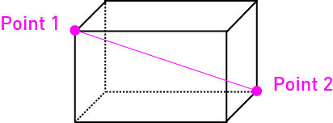
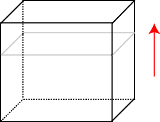
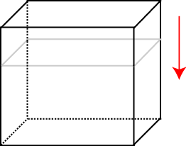

# 选区 { #selection }

操作选区或区域是 WorldEdit 的基础。例如，要将一块正方形区域内的所有玻璃替换为泥土，就必须先告诉 WorldEdit 该区域位于何处。WorldEdit 提供多种选择待编辑区域的方式。本节会介绍如何选择区域，以及可以对选区做哪些操作。

<a id="contents"></a>

- [想显示选区边界线？](#want-to-see-selection-lines)

- [选择长方体](#selecting-cuboids)

- [调整选区](#adjusting-the-selection)

- [选区信息](#selection-information)

- [选区模式](#selection-modes)

## 想显示选区边界线？ { #want-to-see-selection-lines }

要显示选区边界线，可以选择以下方式：

1. 通过 `//drawsel` 使用服务端提供的有限选区边界显示。它只支持不超过 48x48x48 的长方体选区，旧版上限为 32x32x32，而且必须处于创造模式。这些限制来自 Minecraft 长期以来的结构方块实现。

2. 使用第三方客户端模组，例如 [WorldEdit CUI（Fabric）](https://modrinth.com/mod/worldedit-cui)。此模组需要 Fabric，因此必须先安装 Fabric。

!!! note "注意"

    使用 Minecraft 1.12 或更早版本时，除了下载旧版 WorldEdit（版本 6），可能还需要 [Mumfrey 开发的旧版 WorldEditCUI](https://www.minecraftforum.net/forums/mapping-and-modding-java-edition/minecraft-mods/1292886-worldeditcui)。它需要的是 LiteLoader，安装步骤见对应页面。

## 选择长方体 { #selecting-cuboids }

WorldEdit 允许通过选择长方体两个角上的点来选定**长方体**（可以将它想象成三维矩形）。下图展示了两个点如何确定一个长方体。所选长方体只能与世界坐标轴对齐，无法倾斜旋转。

!!! tip "提示"

    还可以选择二维多边形、椭球、球体、圆柱体等其他形状。本页后面会介绍这些选区模式。





选择这两个点有多种方式，也可以混合使用。

### 使用工具选择 { #selecting-with-the-wand }

```text
//wand
```

最直观的方式是使用选区工具。执行 `//wand` 获取工具（默认为木斧）。用工具**左键单击**方块，将它标记为长方体的第一个角；**右键单击**选择第二个角。

可以通过更改[配置](../../config.md)或使用 `/tool selwand` 命令，将选区工具绑定到其他物品。就这一点而言，它也是一种[工具](../tools/tools.md)。

### 选择自身位置 { #selecting-at-your-own-location }

```text
//pos1
//pos2
```

这些命令会将第一个或第二个角设为脚下所站方块的上一个方块。通常选区工具就足以完成大多数任务，不太需要使用这种方式。但在空中飞行、没有方块可供工具单击时，它就很有用。

### 选择指定位置 { #selecting-a-specific-location }

```text
//pos1 x,y,z
//pos2 x,y,z
```

这些命令会将第一个或第二个角设为给定坐标的方块。如果已提前算好需要操作的准确坐标，就可以使用这种方式。

### 通过准星选择 { #selecting-with-your-crosshair }

```text
//hpos1
//hpos2
```

这些命令会将第一个或第二个角设为当前看向的方块。因此可以从远处选择点，方便地创建很大的长方体选区。

### 选择当前区块 { #selecting-the-current-chunk }

```text
//chunk
```

此命令会选中你所在区块内的全部方块。区块长宽为 16，高为 256 个方块。改用 `//chunk -s`，会选中当前选区涉及的*全部*区块。

## 调整选区 { #adjusting-the-selection }

### 扩展选区 { #expanding-the-selection }

```text
//expand <amount> [direction]
//expand <amount> <reverse-amount> [direction]
//expand vert
```

此命令可以通过以下几种方式扩展区域：

- 指定方向

- 看向所需方向（仅限正方向）

- 从天空扩展到基岩（使用 `vert`）

指定方向时，使用“N”“S”“W”“E”“U”（上）或“D”（下）。如果只想根据视线确定方向，则使用“me”，或省略方向参数。

也可以指定相对方向，例如“F”（前，与“me”相同）、“B”（后）、“L”（左）、“R”（右），均相对于当前面朝方向。

还可以用逗号分隔多个方向，一次向多个方向扩展，例如 `//expand 10 n,w`。

可以指定两个数值，让选区同时向两个相反方向扩展。

示例：向上扩展





例如，使用 `//expand 10 up`，选区会如图所示向上扩大。

### 收缩选区 { #contracting-the-selection }

```text
//contract <amount> [direction]
//contract <amount> <reverse-amount> [direction]
```

此命令与 `//expand` 类似，但作用是收缩。

示例：向下收缩





选区会从哪一侧收缩？使用 `//contract 10 down` 时，选区会从顶部缩小。

### 内缩与外扩 { #inset-and-outset }

!!! tip "提示"

    如果想同时向所有方向扩展或收缩（或只沿水平或竖直方向），可以使用 `//outset` 和 `//inset` 命令。例如，`//outset -v 5` 会让选区在竖直方向向上、向下各扩展 5 个方块；`//inset -h 5` 会在水平方向向北、西、南、东各收缩 5 个方块。省略 `v` 或 `h` 时，会作用于全部 6 个方向。

### 裁剪选区 { #trimming-the-selection }

```text
//trim [mask]
```

此命令会将选区缩小到仍能容纳所有匹配给定蒙版的方块的最小范围。不指定蒙版时，会像使用 `#existing` 蒙版一样，让选区恰好容纳所有非空气方块。

## 选区信息 { #selection-information }

WorldEdit 还提供了获取所选区域信息的命令。

### 获取选区大小 { #getting-selection-size }

```text
//size [-c]
```

获取选区的面积和尺寸。

使用 `-c` 选项时，测量剪贴板大小，而不是选区。

### 统计方块数量 { #counting-block-frequency }

```text
//count <mask>
```

统计选区内匹配蒙版的方块数量。

### 查看方块分布 { #finding-the-block-distribution }

```text
//distr [-cd]
```

显示所选区域内的方块分布。

使用 `-c` 选项时，操作剪贴板，而不是选区。

`-d` 选项会按方块状态细分，而不只是按类型。

示例：方块分布输出

仅按方块类型：

```text
75      (52.083%) Air (minecraft:air)
41      (28.472%) Grass Block (minecraft:grass_block)
18      (12.500%) Rose Bush (minecraft:rose_bush)
5       (3.472%) Grass (minecraft:grass)
```

按状态细分：

```text
75      (52.083%) Air (minecraft:air)
41      (28.472%) Grass Block (minecraft:grass_block[snowy=false])
9       (6.250%) Rose Bush (minecraft:rose_bush[half=upper])
9       (6.250%) Rose Bush (minecraft:rose_bush[half=lower])
5       (3.472%) Grass (minecraft:grass)
```

## 选区模式 { #selection-modes }

使用 `//sel <mode>` 命令可以切换不同的形状。使用较复杂的形状时，建议安装 CUI 模组，以便直观看到所选内容。

`//sel cuboid`

标准长方体选区模式，详见上文。

`//sel extend`

左键单击选择第一个点，之后都用右键单击选择。每次右键单击都会扩展长方体选区，使其包含新点。

`//sel poly`

左键单击选择第一个点，之后都用右键单击选择。每次右键单击都会添加一个点。顶部和底部始终包含所选的最高点和最低点。

`//sel ellipsoid`

左键单击选择中心，右键单击扩展。根据单击位置不同，可以分别控制 x、y、z 方向的半径。

`//sel sphere`

左键单击选择中心，右键单击扩展。选区始终是以第一个点为球心、到第二个点的距离为半径的球体。

`//sel cyl`

左键单击选择中心，右键单击扩展。可以控制 x 和 z 方向的半径，高度则始终包含最高点和最低点。

`//sel convex`

左键单击选择第一个点，之后都用右键单击选择。选区是包围所有选定点的凸包。
