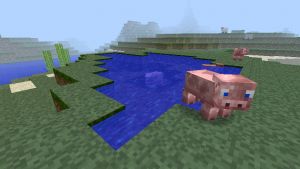
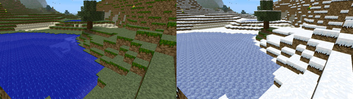

# 实用工具 { #utilities }

WorldEdit 提供了一些实用命令，方便完成常见任务，否则这些任务通常需要多条命令和多次选择。所有这些命令都基于放置位置操作，默认是玩家位置，但可以通过 `/toggleplace` 命令改为选区的第一个点。

<a id="contents"></a>

- [编辑附近方块](#editing-nearby-blocks)

- [填坑](#filling-pits)


  - [递归填充](#recursive-fill)

- [排空水池](#draining-pools)

- [修复水池](#fixing-pools)

- [模拟降雪](#simulating-snowfall)

- [融雪](#thawing-snow)

- [模拟草地生长](#simulating-grass-growth)

- [灭火](#extinguishing-fires)

- [移除生物](#removing-mobs)

## 编辑附近方块 { #editing-nearby-blocks }

有时只想设置或替换周围区域内的方块，并不需要精确选区。

移除上方和下方的方块：

```text
/removeabove <size> [height]
/removebelow <size> [depth]
```

这两个命令可以方便地移除上方或下方的方块，例如清除玩家为登高而搭建的方块柱。大小参数表示要移除的长方体大小，长和宽均为 `(size - 1) * 2 + 1`。长方体中心是脚下所站方块的上一个方块。不指定高度或深度时，命令会一直延伸到世界边界。

移除附近方块：

```text
/removenear <mask> <size>
```

此命令会移除附近指定类型的方块。大小参数表示要移除的长方体大小，长和宽均为 `(size - 1) * 2 + 1`。长方体中心是脚下所站方块的上一个方块。

替换附近方块：

```text
/replacenear <size> <mask> <pattern>
```

如果需要快速替换附近方块，此命令是方便的快捷方式。大小参数表示要替换的长方体大小，长和宽均为 `(size - 1) * 2 + 1`。长方体中心是脚下所站方块的上一个方块。

## 填坑 { #filling-pits }

```text
//fill <pattern> <radius> [depth]
```

填充命令会从放置位置开始，向外及向下扩展，用给定方块模式填充空气。它只会从起始层垂直向下处理，因此能填满池塘，却无法填满越往下越向外扩展的洞穴。

填充命令绝不会从起始位置向上填充。

<a id="id1"></a>



*用 `//fill` 填满的不规则水池。由于区域无法恰好放进一个长方体，这种情况下无法用 `/replace` 将空气替换为水。*

### 递归填充 { #recursive-fill }

```text
//fillr <pattern> <radius>
```

与普通填充命令不同，递归填充在向下移动时*会*向外扩展，因此可以填满洞穴和其他向墙内扩展的孔洞。

与普通填充一样，它不会向上超过起始 y 高度。

## 排空水池 { #draining-pools }

```text
//drain [-w] <radius>
```

排空命令可以清空水池或熔岩池。它只移除与起始位置相连的方块，因此即使其他池子在半径内，只要不相连也不会被排空。

添加 `-w` 选项还会移除含水方块中的水，使其变干。

!!! note "注意"

    某些方块（例如海带和海草）看起来像是含水方块，实际上却没有“干燥”状态。如果要排空含有这些方块的海洋或河流，先使用上文介绍的 `//removenear` 移除它们。

## 修复水池 { #fixing-pools }

```text
/fixwater <radius>
/fixlava <radius>
```

此命令会将半径内的“流动”熔岩和水替换为“静止”状态。过去，水景被水桶取走一部分水，或因方块被破坏而受损时，这个功能很有用。但 Mojang 在较近的版本中更改了水的机制，因此 `fixwater` 已不如以前有用。

## 模拟降雪 { #simulating-snowfall }

```text
/snow <radius>
```

在周围区域覆盖积雪！算法只会给适合覆盖积雪的方块加雪（例如不会覆盖火把）。如果区域上方有物体遮挡（例如悬挑部分），雪就落不到那里。“降雪”完全沿竖直方向进行。

!!! note "注意"

    降雪命令目前还不会累积雪层厚度。

<a id="id2"></a>



*降雪改变地貌*

## 融雪 { #thawing-snow }

```text
/thaw <radius>
```

此命令与上文的 `/snow` 正好相反，会移除无遮挡区域的雪和冰。

## 模拟草地生长 { #simulating-grass-growth }

```text
/green [-f] <radius>
```

让周围区域长满草！此操作沿水平方向向外扩展，将泥土转换为草方块。

使用 `-f` 选项时，除了普通泥土，也会将砂土转为草方块。

## 灭火 { #extinguishing-fires }

```text
/ex [radius]
```

这本质上是 `/removenear fire <radius>` 的快捷方式，方便快速灭火。

## 移除生物 { #removing-mobs }

```text
/butcher [-pngabtfl] [radius]
```

此命令会移除附近生物。如果不指定半径，将移除当前已加载世界中的所有活动生物。生物不会掉落战利品。即使杀死了所有生物，如果没有其他机制阻止生成，它们很快又会出现。

清除生物选项

<table>
<colgroup>
</colgroup>
<tbody>
<tr>
<td markdown="span">**选项**</td>
<td markdown="span">**说明**</td>
</tr>
<tr>
<td markdown="span">`-p`</td>
<td markdown="span">杀死已驯服的宠物</td>
</tr>
<tr>
<td markdown="span">`-n`</td>
<td markdown="span">杀死 NPC</td>
</tr>
<tr>
<td markdown="span">`-g`</td>
<td markdown="span">杀死傀儡</td>
</tr>
<tr>
<td markdown="span">`-a`</td>
<td markdown="span">杀死动物</td>
</tr>
<tr>
<td markdown="span">`-b`</td>
<td markdown="span">杀死环境生物</td>
</tr>
<tr>
<td markdown="span">`-t`</td>
<td markdown="span">杀死有命名牌名称的生物</td>
</tr>
<tr>
<td markdown="span">`-f`</td>
<td markdown="span">组合以上所有选项</td>
</tr>
<tr>
<td markdown="span">`-r`</td>
<td markdown="span">杀死盔甲架</td>
</tr>
</tbody>
</table>
