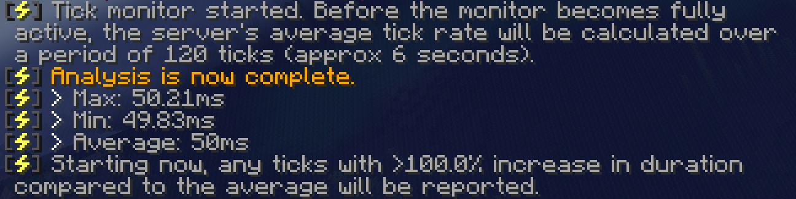
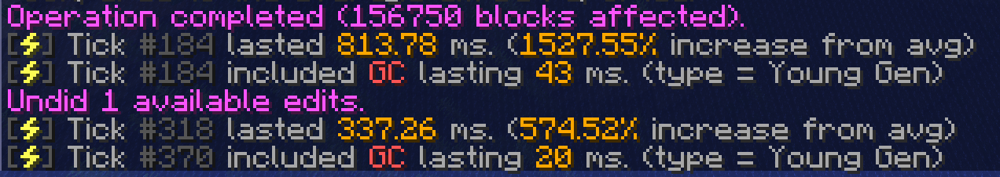
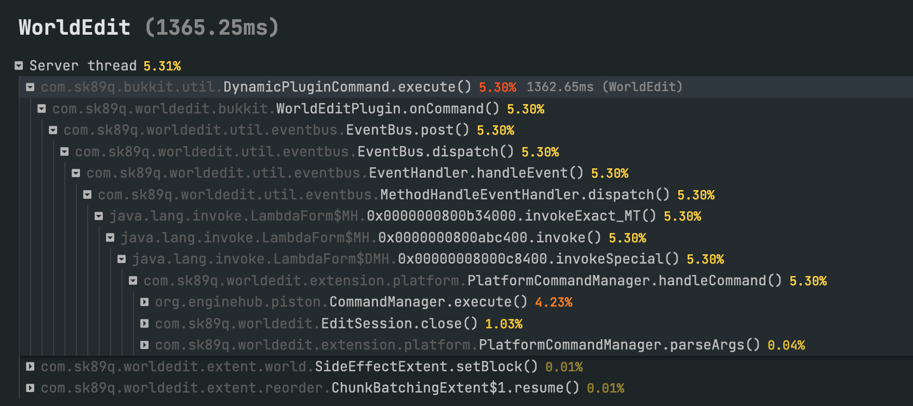

# 查找卡顿尖峰的原因

当少数几个游戏刻（有时只有一个）执行时间很长时，就会出现卡顿尖峰。

这种情况可能很频繁，例如每 20 个游戏刻就有一次；也可能很少见，例如每分钟一次。它通常与玩家的行为有关。

只看普通的性能采样数据，很难查明卡顿尖峰的原因，因为数据经过了平均处理。其他采样会“抵消”尖峰，掩盖它的影响。

spark 提供了两个有用的工具来解决这个问题。

### 第 1 步：用 `/spark tickmonitor` 检测卡顿尖峰

要在性能报告中找出卡顿尖峰的原因，需要先把出现“尖峰”的游戏刻与其他游戏刻区分开。

可以使用 [`/spark tickmonitor`](../commands.md#spark-tickmonitor) 命令。

这个命令会先确定服务器的平均游戏刻耗时，然后：

- 监控此后每个游戏刻的耗时。
- 计算上一个游戏刻的耗时与平均值之间的差异，以百分比表示。
- 如果差异超过指定阈值，就在聊天栏发送消息。

执行 `/spark tickmonitor` 即可开启监控。

默认阈值为 100%（增加 100% 表示该游戏刻的耗时是平均值的两倍）。

也可以把阈值指定为绝对的游戏刻耗时。例如，`/spark tickmonitor --threshold-tick 50` 会报告所有超过 50 毫秒的游戏刻；达到这个时间点时，服务器就得开始追赶进度，或出现卡顿。

接下来只需等待。如果尖峰已经能在游戏中明显感受到，试着将游戏中的卡顿表现与监控输出对应起来。

如果输出还不够敏感，可以尝试降低阈值，例如 `/spark tickmonitor --threshold-tick 70`。

为了便于说明，这里用 WorldEdit “制造”一次卡顿尖峰。:)

可以看到，执行 WorldEdit 操作时，相应游戏刻的耗时增加了超过 1000%！

### 第 2 步：用 `/spark profiler` 的 `--only-ticks-over` 选项查找原因

[`--only-ticks-over`](../commands.md#spark-profiler) 选项会让 spark 只对超过指定阈值的游戏刻进行性能采样。这样可以过滤掉所有“正常”的游戏活动，只留下需要关注的卡顿游戏刻。

可以通过第 1 步确定合适的阈值。作者建议使用 50 到 100 之间的值，但这个值始终应小于卡顿游戏刻的实际耗时。

例如，第 1 步示例中的卡顿操作耗时超过 300 毫秒；为保证它们被包含在内，这里采用更低的 150 毫秒作为阈值。

然后执行，例如 `/spark profiler --only-ticks-over 150`。

这会启动新的性能采样，但只收集执行时间超过 150ms 的游戏刻。

完成后，打开查看器，像平常一样检查性能报告。这样通常就能更清楚地看出卡顿发生在哪里。:)

例如……

