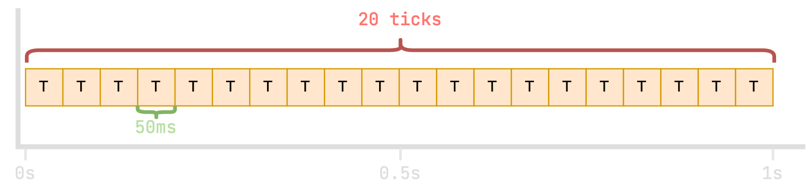
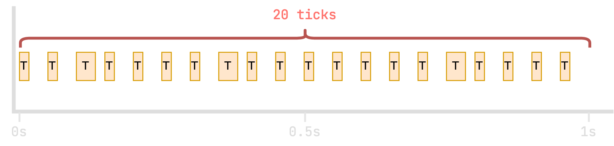
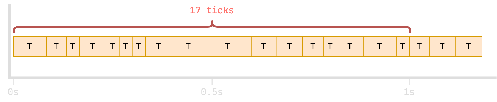
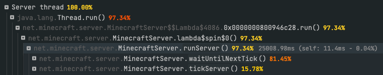

# 游戏刻循环

几乎所有电子游戏（包括 Minecraft）都由一个大型程序循环驱动。服务器（以及游戏）的执行过程被划分为一个个“游戏刻”（tick）。

每次进入一个游戏刻，游戏服务器都会完成多项工作，包括：

- 处理玩家发来的数据包，例如移动、放置或破坏方块、攻击其他实体。
- 更新玩家和其他实体的位置。
- 向所有玩家发送数据包，告知服务器上发生的事情，例如方块变化、实体移动和动作。
- 自然生成生物、处理生物 AI、寻路等。
- 处理红石更新。

还包括其他工作！

## Minecraft 中的游戏刻

Minecraft 服务器的目标是**每秒恰好运行 20 个游戏刻**，也就是**每 50 毫秒运行一个游戏刻**。

每个游戏刻需要完成的工作量，会随游戏中发生的事情而**变化**，所以实际的游戏刻不会如此规律！

### 服务器正常运行时

服务器正常运行时，执行一个完整游戏刻所需的时间应小于（或等于）50 毫秒。

如果一个游戏刻的耗时不足 50 毫秒，服务器就会在剩余时间内“休眠”，直到该执行下一个游戏刻。

例如：

- 服务器用 15 毫秒执行一个游戏刻。
- 游戏刻循环控制器再“休眠”（不做任何事情）35 毫秒，然后开始执行下一个游戏刻。

这个示例中的所有游戏刻都在 50 毫秒内执行完毕，但它们之间保留了间隔，以保证每秒恰好处理 20 个游戏刻。

如果服务器不把游戏刻间隔开来（在中间休眠），游戏实际上就会显得更快，所有事情都会更快地发生！

### 服务器卡顿时

如果一个游戏刻耗时超过 50 毫秒，下一个游戏刻就必须延后执行，因为游戏刻无法并行执行。这时游戏体验开始下降，操作响应变慢，出现卡顿。

当某个游戏刻开始耗时更长时，后续内容都会“向右移动”，相同时间内完成的游戏刻就会减少。这就是服务器卡顿时，所有事情都会变慢的原因。

从这里也能看出 **TPS**（每秒游戏刻数）和 **MSPT**（每游戏刻毫秒数）这两个指标的由来。

在上面的示例中：

- spark 报告的 TPS 为 **17**，因为这一秒只处理了 17 个游戏刻。
- spark 报告的最小 MSPT 约为 **~20ms**（良好），最大 MSPT 约为 **~80ms**（超过 50ms，状况不佳）。

## spark 性能报告中的游戏刻

在 spark 性能报告中，可以清楚地辨认出游戏刻循环，它通常就在接近顶部的位置！

在上面的示例中，`waitForNextTick()` 占了 “Server thread” 上 81% 的 CPU 活动。这是正常的！这表示平均而言，服务器可以把每个游戏刻分配到的 50 毫秒中的约 80% 用来休息，不做任何事情。

这说明服务器还有富余的处理能力。如果活动量突然增加，例如更多玩家加入，或更多实体、方块需要更新，服务器应该还能应付。

一般来说：

- 休眠时间占比越高越好。
- 休眠占比低于 20%（游戏刻处理占比超过 80%）时，服务器负担已经较重，*某些*游戏刻可能出现卡顿。记住，这些都是平均值！
- 休眠占比低于 5%（游戏刻处理占比超过 95%）时，服务器很可能已经在卡顿，没有富余的处理能力。

**最后还要记住：这些数值都是平均值！**

假设服务器处理*大多数*游戏刻只需 20 毫秒（正常），但偶尔处理*某些*游戏刻却要 300 毫秒（不正常）。如果你遇到的是“卡顿尖峰”，而非整体性能不佳，很可能就是这种情况。

这时，“休眠”和“游戏刻处理”的百分比会产生误导，因为极端值被平均掉了。
