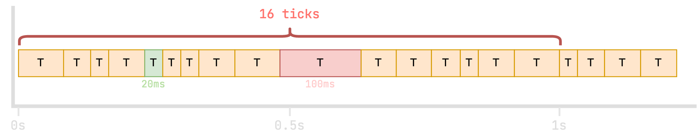
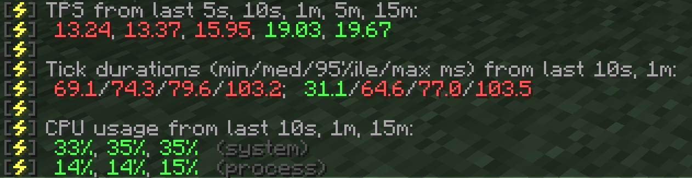

# TPS 与 MSPT

[`/spark tps`](../commands.md#spark-tps) 命令会显示服务器的 TPS（每秒游戏刻数）和 MSPT（每游戏刻毫秒数）。这些数值代表什么？

这两个指标是了解游戏运行状况的主要方式。它们与[游戏刻循环](tick-loop.md)有关：完成了多少个游戏刻，以及每个游戏刻平均耗时多久。

## TPS（每秒游戏刻数）

TPS 表示游戏平均每秒处理多少个游戏刻。

正常、流畅运行时，理想值是每秒 **20** 个游戏刻。

为此，每个游戏刻的平均耗时需要不超过 50 毫秒。

在这个示例中，一些游戏刻耗时超过 50 毫秒，一秒内只完成了 16 个游戏刻。如果平均下来一直如此，spark 就会报告服务器正以 **16 TPS** 运行。

## MSPT（每游戏刻毫秒数）

MSPT 表示游戏处理每个游戏刻平均需要多少毫秒。

正常、流畅运行时，理想值是每个游戏刻 **50 毫秒或更少**。

再看同一个示例，可以看到各个游戏刻的耗时有所不同。

“最快”的游戏刻只用了 20 毫秒，spark 会将它报告为 “min MSPT”（最小 MSPT）。
“最慢”的游戏刻用了 100 毫秒，spark 会将它报告为 “max MSPT”（最大 MSPT）。

spark 还会根据这些数据计算中位数和第 95 百分位数。

#### 在命令输出中的含义

这就是 `/spark tps` 命令中各项数值的含义。😎

spark 会根据这些数值反映的服务器性能好坏，自动以*绿色*、*琥珀色*或*红色*突出显示。
