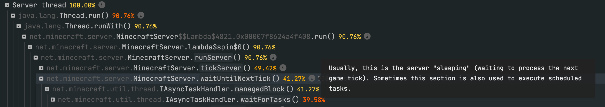

<a id="info-points"></a>

# 信息提示点

spark 的“信息提示点”是在查看器中为常见或值得注意的调用栈帧附加的简短说明。用户将鼠标悬停在 **ⓘ** 图标上时，就会显示。



这些说明是开源的，社区成员可以比较方便地编辑、修改和改进。如果发现内容有误，或认为某个线程、方法调用值得补充说明，欢迎参与完善！:sunglasses:

<a id="contributing"></a>

## 参与完善

说明内容以一组较简单的 YAML 文件保存在 GitHub 仓库 **[lucko/spark-infopoints](https://github.com/lucko/spark-infopoints)** 中。

文件根据说明内容涉及的对象分类。文件名只用于方便整理仓库，除此之外没有特殊作用。

可以将仓库克隆到本地再修改，也可以直接使用 GitHub 网页上的文本编辑器。:)

<a id="method-description-format"></a>

### 方法说明的格式

方法说明的格式如下：

```yaml
- method: net.minecraft.network.protocol.PlayerConnectionUtils.run()
  description: >
    Manages player (client) connections to the server, in particular the processing of incoming
    packets (actions performed by players).
```

- `method` 键应填写 spark 查看器中显示的方法名，即应用映射后的名称。
- `description` 键应填写要在查看器中显示的说明，使用 Markdown 格式。

<a id="thread-description-format"></a>

### 线程说明的格式

说明的格式如下：

```yaml
- thread: Server thread
  description: >
    The main server thread that the game loop is executed on. See the
    [Tick Loop guide](https://spark.lucko.me/docs/guides/The-tick-loop) for more info.
```

- `thread` 键应填写 spark 查看器中显示的线程名。
- `description` 键应填写要在查看器中显示的说明，使用 Markdown 格式。

<a id="multiple-methodsthreads-with-the-same-description"></a>

### 为多个方法或线程使用相同说明

如果多个方法或线程需要使用相同的说明，可以改用复数形式的键，并填写列表，将它们分组：

```yaml
- methods:
  - net.minecraft.server.MinecraftServer.waitUntilNextTick()
  - net.minecraft.server.IAsyncTaskHandler.sleepForTick()
  description: >
    todo
```

```yaml
- threads:
  - Server thread
  - Main thread
  description: >
    todo
```

<a id="regex-match"></a>

### 正则表达式匹配

`method` 和 `thread` 键通常进行精确匹配。不过，也可以在模式两侧加上 `/`，改用正则表达式匹配。

```yaml
- thread: /^Craft Scheduler Thread.*$/
  description: >
    todo
```
