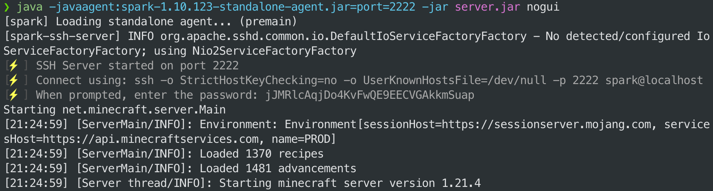
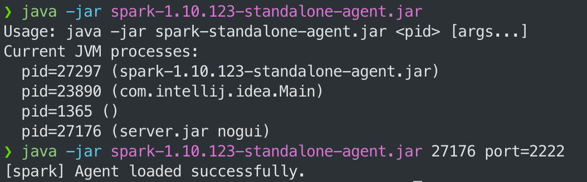
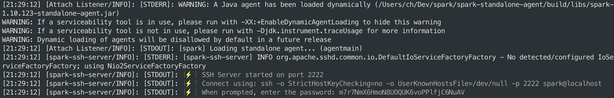
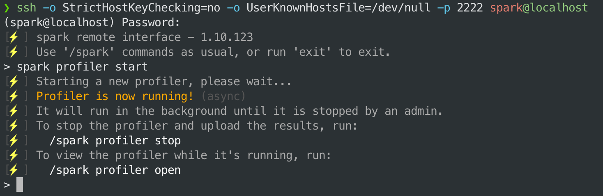

<a id="standalone-agent"></a>

# 独立 Agent

除了作为插件或模组在 Minecraft 服务端、客户端、代理端上运行，spark 也能分析运行在 Java 虚拟机（JVM）上的各类应用，例如 Web 应用、Discord 机器人，以及其他使用 Java、Kotlin、Scala 等语言编写的应用。

实现方式是将 spark 作为 “Java agent” 附加到 JVM。

!!! tip "提示"

    此方法也适用于未安装模组的原版 Minecraft 客户端或服务端，因为它们本质上也是 Java 应用。下方示例演示的就是这种用法。

    spark 对原版 Minecraft 服务端有额外集成，分析原版服务器时会自动应用反混淆映射。

<a id="installation-attach-at-startup"></a>

## 安装（启动时附加）

从[下载页面](https://spark.lucko.me/download)下载 spark 独立 agent JAR。

然后在启动应用时，在命令开头加入下面的 `-javaagent` 参数。

例如：

```bash
java -javaagent:spark-x.y.z-standalone-agent.jar -jar application.jar [application args]
```

还可以用 `port` 参数指定 agent 的监听端口。例如：

```bash
java -javaagent:spark-x.y.z-standalone-agent.jar=port=2222 -jar application.jar [application args]
```



<a id="installation-attach-to-a-running-process"></a>

## 安装（附加到运行中的进程）

要把 spark 独立 agent 附加到已经运行的 Java 应用，可以执行以下命令：

```bash
# replace <pid> with the process ID of the running Java application
java -jar spark-x.y.z-standalone-agent.jar <pid>

# or with a specific port
java -jar spark-x.y.z-standalone-agent.jar <pid> port=2222
```

运行此 JAR 时如果不提供 PID，会列出所有运行中的 Java 进程及其 PID。



agent 附加完成后，连接说明会输出到应用自身的控制台或日志中。



<a id="usage-ssh-interface"></a>

## 用法（SSH 界面）

agent 附加后，可以通过专用的 SSH 界面与它交互。agent 启动时，会将连接说明输出到应用的控制台或日志中。

将 ssh 命令复制粘贴到新的终端窗口，然后按提示输入密码。



进入 SSH 界面后，就可以执行常用的 [spark 命令](commands.md)，也可以使用专用的 `exit` 命令断开连接。

<a id="agent-arguments"></a>

## Agent 参数

附加 agent 时可以指定以下参数：

- `port={port}`：agent 的监听端口，默认值为 `2222`。
- `start`：带有此参数时，agent 附加后会立即开始性能采样。
- `open`：带有此参数时，附加后会在控制台或日志中输出查看器链接。

多个参数之间用逗号分隔。例如：

```bash
java -javaagent:spark-x.y.z-standalone-agent.jar=port=2222,start,open -jar application.jar
```
