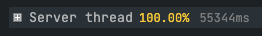
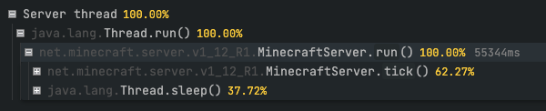
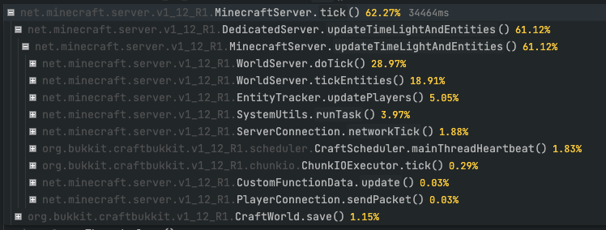
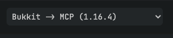
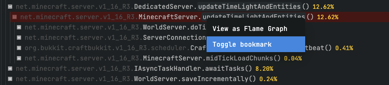
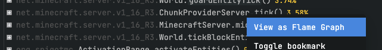
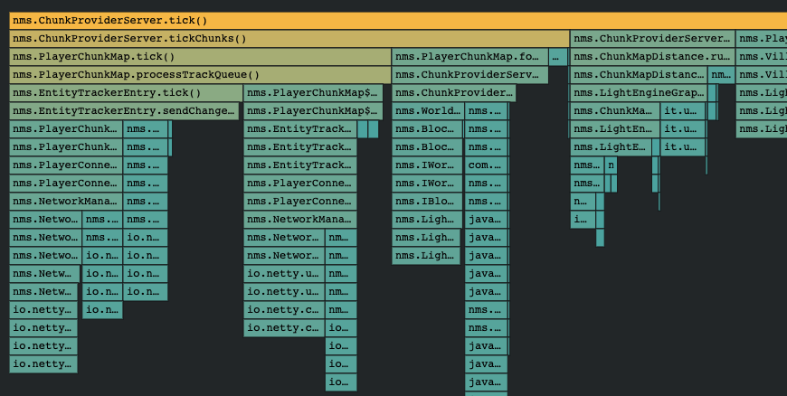
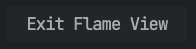

# 使用查看器

用 [`/spark profiler`](commands.md#spark-profiler) 命令生成性能报告后，报告会自动上传到查看器，并向你提供一个链接。

这个链接可以自由分享给其他人，例如正在帮助你排查问题的人，或需要了解问题的插件、模组开发者。

## 理解性能采样树

第一次看到性能采样输出时，可能会觉得有些复杂，难以理解。

部分原因在于，spark 能获取并显示的只有底层的类名和方法名，也就是程序员在代码中使用的名称。不过，稍加思考并结合常识，通常就能理解发生了什么。

耐心看下去！下面的说明会帮助你理解这些输出。:smiley:

### 线程

首次打开查看器时，会看到本次采样涉及的**线程**列表。

可以把线程看作客户端、服务器等程序中负责某项具体工作的工人。对于 Minecraft *服务器*，通常最值得关注的是 “Server thread”，即负责运行游戏的主线程。

### 调用栈帧（“节点”）

性能采样树中的每个调用栈帧会显示三项信息：*名称*、它占线程总耗时的*百分比*，以及耗时的毫秒数（仅在鼠标悬停时显示）。

线程位于报告的根部或顶部，旁边始终显示 `100%`，因为对该线程进行采样的全部时间，自然都花在该线程内。

将鼠标**悬停**在性能采样树的节点上时，右侧会显示采样器估算的本次采样期间执行该节点所花的时间。

### 信息提示点

一些常见或值得注意的调用栈帧旁边会显示 **ⓘ 信息提示点**符号。

将鼠标悬停在此符号上，查看器会显示额外信息，说明这个调用栈帧与什么有关。

这些说明是开源的，社区成员可以比较方便地编辑、修改和改进。如果发现内容有误，或认为某个线程、方法调用值得补充说明，欢迎[参与完善](misc/info-points.md)！:sunglasses:

### 展开性能报告

**点击**一个节点，即可在下方展开它的**子节点**。

在这个示例程序中展开 “Server thread” 后：

- 唯一的子节点是 `java.lang.Thread.run()`，这只是服务器线程的入口，可以忽略。
- 它唯一的子节点是 `MinecraftServer.run()`，这就是 Minecraft 服务器的入口。
- 后者的两个子节点分别是 `MinecraftServer.tick()` 和 `Thread.sleep()`。

正如[游戏刻循环指南](guides/tick-loop.md)所述，花在休眠或线程 “parked”（停驻）状态上的时间是正常的，通常可以忽略。

真正执行工作的地方是 `MinecraftServer.tick()`，可以点击它继续展开。

### 分析性能报告

到这里，就能看到服务器不同部分的执行情况。

已经可以看到的一些关键内容：

- `WorldServer.doTick()`：很可能在更新世界，例如方块、红石等。
- `WorldServer.tickEntities()`：很可能在更新实体，这样判断通常没错。
- `CraftScheduler.mainThreadHeartbeat()`：CraftBukkit 正在执行插件调度任务。
- 其他方法也类似，通常能据此大致判断正在做什么。

如果不知道某个方法名代表什么，或需要进一步了解细节（通常都会需要），可以继续展开节点。

### 如何查找性能问题的原因

了解如何浏览调用树后，查找“有问题”部分的诀窍就是顺着数值往下看，尤其关注**每个节点旁边**的**百分比**。

这些百分比表示时间有多少花在了对应部分。

继续展开树，沿着百分比*相对*较高的部分往下查，通常最终就能找到问题所在。

[查找卡顿尖峰指南](guides/finding-lag-spikes.md)演示了这一过程。

## 应用反混淆映射

Minecraft 客户端和服务端会对所有方法名、类名进行混淆，使名称难以辨认。这会给查找性能问题的原因带来麻烦。

查看器可以应用反混淆映射，把这些名称还原。

默认情况下，**查看器会自动检测应使用哪套映射**。如果自动检测没有生效，可能需要手动选择正确的映射。

使用页面**右上角**的**下拉菜单**即可选择。

## 为方法调用添加书签

分析性能报告时，可能会遇到值得注意的方法调用，想保存下来以便之后查阅，或展示给其他人。

最方便的方式是给这个方法添加“书签”。

按住 `alt` 键并点击方法调用即可。

也可以**右键点击**方法调用，再选择 **Toggle bookmark（切换书签）**。

这个方法随后会以红色高亮。

同时，浏览器地址栏的 URL 中会添加一个特殊查询参数，用来记录书签。将修改后的链接**分享**给其他人后，对方打开查看器时，你标记的方法也会自动展开并高亮。

## 视图

性能报告查看器支持几种不同的视图模式。

点击顶部工具栏中的 `👁️` 视图按钮，即可切换。

### All View（完整视图）

默认的性能报告视图，以可展开的树显示整个报告。

### Flat View（平铺视图）

平铺视图把性能报告展平，将耗时最长的 250 个方法调用列在最上层。它适合查看哪些方法调用的总耗时最多。

此视图有两种 **Display（显示）**模式。

| 显示模式 | 说明 |
| --- | --- |
| **Top Down（自顶向下）** | 正常的调用树，展开节点后显示它调用的子方法。 |
| **Bottom Up（自底向上）** | 反向调用树，展开节点后显示调用它的方法。 |

此视图有两种 **Sort（排序）**模式。

| 排序模式 | 说明 |
| --- | --- |
| **Total Time（总耗时）** | 按方法的总耗时排序，包括执行方法自身代码和子调用所花的时间。 |
| **Self Time（自身耗时）** | 按方法自身耗时排序，只计算执行方法自身代码的时间。 |

### Sources View（来源视图）

如果专门想查找性能较差的插件或模组，**来源**视图会很有用。

来源视图会为报告中的每个插件或模组单独显示一棵性能采样树。调用树经过筛选，最上层显示该来源发起的全部调用。

此视图有两种 **Merge（合并）**模式。

| 合并模式 | 说明 |
| --- | --- |
| **Merge（合并）** | 将签名相同的方法调用合并在一起，即使它们并非由同一个方法调用。 |
| **Separate（分开）** | 签名相同、但并非由同一个方法发起的调用会分别显示。 |

## 火焰图

火焰图是常用的性能采样结果阅读方式。

查看器可以方便地把整份性能报告或其中一部分显示为火焰图。

点击顶部工具栏的火焰图标，或**右键点击**线程、方法调用并选择 **View as Flame Graph（以火焰图查看）**，即可打开火焰图视图。

随后会打开火焰图视图。

这个视图中，每个节点的**宽度**都**对应**执行它所花时间的占比。

**点击**某个节点可以将它设为**焦点**，使其扩展到页面的整个宽度。下方子节点也会相应扩展。

将鼠标**悬停**在节点上，可查看完整方法名和采样耗时。

要**退出**火焰图视图、返回性能采样树，点击页面**右上角**的 **Exit Flame View（退出火焰图视图）**按钮即可。

